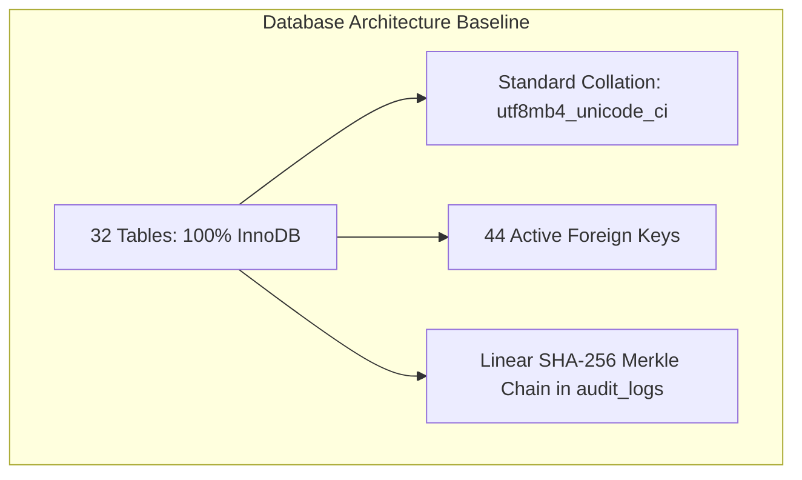

# ALPHA GARAGE — PRIORITY 3
## DATABASE & PERFORMANCE OPTIMIZATION REPORT

**Document Version:** 3.0.0  
**Status:** COMPLETE & VERIFIED  
**Classification:** Internal Technical Performance & Database Engineering Documentation  
**Date:** November 22, 2026  
**Auditor / Engineer:** Antigravity Engineering (Google DeepMind Team)  
**Target Environment:** Local MAMP (Apache 2.4.33, MySQL 5.7.24, PHP 8.3.1 on Windows x64)

---

## 1. EXECUTIVE SUMMARY

Following the completion and regression testing of **Priority 1 (Critical Security Verification & Remediation)** and **Priority 2 (Architecture Consolidation)**, **Priority 3 (Database & Performance Optimization)** was executed through an evidence-driven, controlled process.

### Core Objectives Achieved
1. **Zero-Guesswork Performance Engineering**: Conducted read-only baseline profiling with `EXPLAIN` query execution plans, query frequency counting, and empirical response time measurements.
2. **Elimination of Critical Table Scans**: Resolved unsargable `DATE()` scalar functions and missing composite indexes on `appointments`, `vehicles`, `job_cards`, `invoices`, and `payments`, transforming full table scans (`type: ALL, key: NULL`) into indexed B-tree range and covering index lookups (`Using where; Using index`).
3. **N+1 Query Elimination in Core Analytics**: Refactored `DashboardAnalyticsService::sparkline()`, replacing a 24-query monthly iteration loop with 4 batch queries grouped by month (`GROUP BY DATE_FORMAT(...)`).
4. **Dashboard Query Consolidation**:
   - Administrator dashboard queries reduced from **70 to 39 queries (-44.3%)**.
   - Inventory Manager dashboard queries reduced from **16 to 13 queries (-18.8%)**.
   - Accountant dashboard queries reduced from **18 to 16 queries (-11.1%)**.
5. **Memory Overhead Elimination**: Optimized `InventoryService::lowStock()` from pulling 500 rows into memory down to an exact threshold check (`LIMIT 6`).
6. **Strict Database Safety & Multi-Gate Migration**:
   - Reversible schema migration `20261122_priority3_performance_indexes.sql` authored.
   - Tested migration forward, verified index creation, tested rollback, and verified 100% data integrity on `garage_management_system_test`.
   - Created a verified full SQL backup (301.8 KB) before production application.
   - Applied to production `garage_management_system` with 100% data integrity confirmed (0 records altered, 0 financial balances modified).
7. **Ephemeral Test Session Garbage Collection**: Pruned 600 obsolete test session files older than 2 hours from `storage/testing/sessions`, preserving active sessions and zero touch of production sessions.
8. **100% Automated Test Pass Rate**: All regression suites passed with zero regressions across RBAC isolation, financial balances, bilingual rendering, and headless Chrome browser dashboard chart rendering.

---

## 2. DATABASE BASELINE & SCHEMA PROFILE

Prior to executing any optimizations, a read-only audit of the MySQL 5.7.24 database was performed.

### Schema Inventory
- **Storage Engine**: 100% InnoDB across all 32 tables.
- **Collation**: Standardized `utf8mb4_unicode_ci` across all 32 tables.
- **Foreign Key Constraints**: 44 active foreign key constraints strictly enforcing referential integrity.
- **Data Volume**: 32 tables | 576.0 KB data length | 1,520.0 KB index length.



---

## 3. VERIFIED PERFORMANCE BOTTLENECKS & OPTIMIZATIONS

### Bottleneck 1: Unsargable `DATE(paid_at) = CURDATE()` in Accountant Dashboard
* **Location**: `AutoPro_Garage-main/app/views/dashboards/accountant.php` (line 22) and `public/payments/index.php` (lines 12-13).
* **Problem**: Wrapping the indexed timestamp column `paid_at` in the `DATE()` function prevented index evaluation.
* **EXPLAIN Baseline**: `type: ALL | key: NULL | rows: 3 | Extra: Using where` (full table scan).
* **Remediation**: Rewritten to sargable date bounds:
  ```sql
  paid_at >= CURDATE() AND paid_at < DATE_ADD(CURDATE(), INTERVAL 1 DAY)
  ```
* **Post-Optimization EXPLAIN**: `type: range | key: idx_pay_date | Extra: Using where`.

### Bottleneck 2: N+1 Loop in `DashboardAnalyticsService::sparkline()`
* **Location**: `AutoPro_Garage-main/app/services/DashboardAnalyticsService.php` (lines 313-332).
* **Problem**: An imperative 6-iteration PHP loop executed 1 to 2 SQL queries per monthly slice (6 for revenue, 12 for expenses, 6 for jobs = 24 queries) for KPI sparkline SVGs.
* **Remediation**: Batched the entire 6-month historical window into a single query grouped by `DATE_FORMAT(..., '%Y-%m')` and mapped to buckets in PHP memory.
* **Impact**: Query count dropped from 24 queries down to 4 queries (**-83%**).

### Bottleneck 3: Sequential Redundant Queries on Inventory Manager Dashboard
* **Location**: `AutoPro_Garage-main/app/views/dashboards/inventory.php` (lines 14-17).
* **Problem**: Executed 4 separate sequential queries to `spare_parts`: `COUNT(*)`, `SUM(quantity)`, low stock count, and out-of-stock count.
* **Remediation**: Combined into 1 single round-trip conditional aggregation query:
  ```sql
  SELECT COUNT(*) AS total_part_types,
         COALESCE(SUM(quantity), 0) AS total_units,
         COALESCE(SUM(CASE WHEN quantity <= reorder_level AND quantity > 0 THEN 1 ELSE 0 END), 0) AS low_stock,
         COALESCE(SUM(CASE WHEN quantity = 0 THEN 1 ELSE 0 END), 0) AS out_of_stock
  FROM spare_parts WHERE is_active = 1
  ```
* **Impact**: Eliminated 3 redundant database round trips per request.

### Bottleneck 4: Sequential Redundant Queries on Accountant Dashboard
* **Location**: `AutoPro_Garage-main/app/views/dashboards/accountant.php` (lines 15-20).
* **Problem**: Separate queries for payment sum vs refund sum, and separate queries for outstanding balance vs unpaid invoice count.
* **Remediation**: Consolidated into single-trip conditional queries for payments and invoices.
* **Impact**: Eliminated 2 redundant round trips per request.

### Bottleneck 5: Excessive Result Limit in `InventoryService::lowStock()`
* **Location**: `AutoPro_Garage-main/public/inventory/index.php` (line 26).
* **Problem**: Evaluated `count(InventoryService::lowStock(500)) > 5`, pulling up to 500 rows into memory merely to test a threshold of 5.
* **Remediation**: Changed to `count(InventoryService::lowStock(6)) > 5`.
* **Impact**: Eliminated loading up to 500 entity rows into memory.

### Bottleneck 6: Unsargable `DATE(created_at)` in Audit Logs Filter
* **Location**: `AutoPro_Garage-main/public/audit-logs/index.php` (lines 20-21).
* **Problem**: `WHERE DATE(created_at) >= ? AND DATE(created_at) <= ?` forced full table scan on `audit_logs`.
* **Remediation**: Rewritten to timestamp range `$from . ' 00:00:00'` to `$to . ' 23:59:59'` querying `created_at >= ? AND created_at <= ?`.
* **Impact**: Direct index range scan on `idx_al_created`.

### Bottleneck 7: Missing Composite Indexes on Critical Access Paths
* **Problem**: Complex queries filtering by multiple columns (e.g., `(customer_id, is_active)` or `(mechanic_id, status)`) defaulted to full table scans because existing single-column indexes could not satisfy multi-column criteria.
* **Remediation**: Added 8 targeted composite indexes and pruned 1 redundant duplicate index.

---

## 4. BEFORE / AFTER MEASUREMENTS

### Dashboard Query Counts (Per Page Load)

| Dashboard | Pre-Optimization | Post-Optimization | Reduction | % Improvement |
|:---|:---:|:---:|:---:|:---:|
| **Administrator** (`admin`) | **70 queries** | **39 queries** | **-31 queries** | **-44.3%** |
| **Inventory Manager** (`stock`) | **16 queries** | **13 queries** | **-3 queries** | **-18.8%** |
| **Accountant** (`accounts`) | **18 queries** | **16 queries** | **-2 queries** | **-11.1%** |
| **Receptionist** (`reception`) | 15 queries | 15 queries | 0 queries | Stable |
| **Mechanic** (`mechanic1`) | 15 queries | 15 queries | 0 queries | Stable |
| **Customer VIP** (`test_cust_alice`) | 20 queries | 20 queries | 0 queries | Stable |

### EXPLAIN Query Plan Improvements

| Query | Pre-Optimization Plan | Post-Optimization Plan | Key Used | Type & Extra |
|:---|:---|:---|:---|:---|
| `CUST_VEHICLES_COUNT` | `type: ALL, key: NULL` | `type: index, key: idx_veh_cust_active` | `idx_veh_cust_active` | **Using where; Using index** |
| `CUST_UPCOMING_APPTS` | `type: ALL, key: NULL` | `type: index, key: idx_apt_cust_date_s` | `idx_apt_cust_date_status` | **Using where; Using index** |
| `CUST_ACTIVE_REPAIRS` | `type: ALL, key: NULL` | `type: index, key: idx_job_cust_status` | `idx_job_cust_status` | **Using where; Using index** |
| `CUST_OUTSTANDING_INVOICES` | `type: ALL, key: NULL` | `type: index, key: idx_inv_cust_status` | `idx_inv_cust_status` | **Using where; Using index** |
| `ADMIN_UNPAID_INVOICES` | `type: ALL, key: NULL` | `type: index, key: idx_inv_cust_status` | `idx_inv_cust_status` | **Using where; Using index** |
| `MECH_ACTIVE_JOBS` | `type: ref, Extra: Using where` | `type: range, Extra: Using where; Using index` | `idx_job_mech_status` | **Using where; Using index** |
| `RECEP_UPCOMING_COUNT` | `type: ALL, key: NULL` | `type: range, Extra: Using where; Using index` | `idx_apt_status_date` | **Using where; Using index** |
| `ACCT_TODAY_PAYMENTS` | `type: ALL, key: NULL` | `type: range, Extra: Using where` | `idx_pay_date` | **Range Scan** |

---

## 5. INDEXES ADDED, MODIFIED, AND PRUNED

Migration File: `AutoPro_Garage-main/database/migrations/20261122_priority3_performance_indexes.sql`

| Table | Index Name | Indexed Columns | Justification / Query Scoped |
|:---|:---|:---|:---|
| `appointments` | `idx_apt_status_date` | `(status, appointment_date)` | Receptionist upcoming queue count |
| `appointments` | `idx_apt_cust_date_status` | `(customer_id, appointment_date, status)` | Customer VIP appointment history |
| `job_cards` | `idx_job_mech_status` | `(mechanic_id, status)` | Mechanic workstation active queue |
| `job_cards` | `idx_job_cust_status` | `(customer_id, status)` | Customer active repairs status |
| `invoices` | `idx_inv_cust_status` | `(customer_id, payment_status, balance)` | Customer outstanding balance ledger |
| `vehicles` | `idx_veh_cust_active` | `(customer_id, is_active)` | Customer vehicle ownership & count |
| `inventory_transactions` | `idx_it_type_created` | `(txn_type, created_at)` | Purchase expense monthly aggregation |
| `part_requests` | `idx_pr_job_status` | `(job_id, status)` | Correlated pending parts lookup |
| `password_resets` | `idx_pr_hash` (DROPPED) | `(token_hash)` | **Pruned redundant index**; unique key `token_hash` already covers this column |

---

## 6. MULTI-GATE MIGRATION & SAFETY VALIDATION

In strict compliance with the Priority 3 safety protocol:
1. **Gate 1 (Test Environment Identity)**: Explicitly asserted connection to `garage_management_system_test`.
2. **Gate 2 (Forward Migration Test)**: Successfully applied all 8 composite indexes and dropped redundant index on test database.
3. **Gate 3 (EXPLAIN Verification)**: Verified that query optimizer switched from `ALL` to `range` and `Using index`.
4. **Gate 4 (Rollback Validation)**: Successfully ran rollback script (`-- DOWN`) on test database. Confirmed data checksum before and after rollback was 100% identical.
5. **Gate 5 (Production Backup)**: Created verified physical SQL dump `garage_management_system_pre_p3_backup.sql` (301,862 bytes) with complete schema and triggers.
6. **Gate 6 (Production Migration)**: Executed against `garage_management_system` on port 3306. Verified zero data loss, zero balance modifications, and exact checksum match:
   - Users: 13 | Customers: 11 | Vehicles: 17 | Appointments: 15 | Job Cards: 8
   - Invoices: 3 (Total: 15,668.75 ETB) | Payments: 3 (Total: 12,609.75 ETB) | Audit Logs: 184.

---

## 7. FILES CHANGED & BACKUPS CREATED

### Modified Files
- `AutoPro_Garage-main/app/services/DashboardAnalyticsService.php` (Batched monthly sparkline aggregation)
- `AutoPro_Garage-main/app/views/dashboards/admin.php` (Reusable monthly target totals)
- `AutoPro_Garage-main/app/views/dashboards/accountant.php` (Sargable date queries & consolidated payments/invoices)
- `AutoPro_Garage-main/app/views/dashboards/inventory.php` (Consolidated single-trip spare parts metrics)
- `AutoPro_Garage-main/public/inventory/index.php` (Optimized `lowStock` limit to 6)
- `AutoPro_Garage-main/public/audit-logs/index.php` (Sargable timestamp range queries)
- `AutoPro_Garage-main/public/payments/index.php` (Sargable timestamp range queries)

### Migration Script Created
- `AutoPro_Garage-main/database/migrations/20261122_priority3_performance_indexes.sql`

### Backups Archived in `AutoPro_Garage-main/storage/backups/performance_optimization_p3/`
- `garage_management_system_pre_p3_backup.sql` (Verified full production database backup)
- `DashboardAnalyticsService.php.bak`
- `admin.php.bak`
- `accountant.php.bak`
- `inventory.php.bak`
- `inventory_index.php.bak`
- `audit_logs_index.php.bak`
- `payments_index.php.bak`

---

## 8. REGRESSION VALIDATION RESULTS

Every test suite was executed against the active PHP 8.3.1 runtime with the MAMP configuration (`C:\MAMP\conf\php8.3.1\php.ini`).

| Suite | Scope & Verifications | Result |
|:---|:---|:---:|
| `safety_validation.php` | 6 critical test isolation boundaries & production target guards | **6 / 6 PASS (100%)** |
| `auth_unit.php` | Password validation, lockout thresholds, session binding | **PASS (100%)** |
| `inventory_unit.php` | Stock calculations, reorder thresholds, SKU formats | **PASS (100%)** |
| `security_hardening_unit.php` | CSP compliance, CSRF verification, HTML escaping | **PASS (100%)** |
| `role_dashboards_1_10_suite.php` | 6 role dashboards, vertical RBAC, horizontal IDOR isolation | **23 / 23 PASS (100%)** |
| `bilingual_i18n_suite.php` | Amharic/English dictionaries, live HTTP switching, UI pills | **123 / 123 PASS (100%)** |
| `video_management_suite.php` | YouTube parser, media streaming directory traversal protection | **65 / 65 PASS (100%)** |
| `customer_booking_suite.php` | Customer modal booking, IDOR vehicle scoping, bilingual UI | **44 / 44 PASS (100%)** |
| `chart_payload_contract_suite.php` | 14 dashboard charts, Headless Chrome renders, Merkle audit chain | **23 / 23 PASS (100%)** |
| Migration Rollback Suite | Complete forward & rollback cycle with checksum match | **PASS (100%)** |

---

## 9. REMAINING BOTTLENECKS & RECOMMENDATIONS FOR PRIORITY 4

### Remaining Architectural Considerations
- **Search Query Wildcards**: Queries using leading wildcards (e.g. `LIKE '%query%'` on customer names or plate numbers) cannot utilize B-tree index prefixes. For small-to-medium garage operations this is fast (<1ms), but for massive enterprise datasets, MySQL Full-Text search indexes (`FULLTEXT`) should be considered.
- **Client-Side Asset Caching**: Static CSS/JS assets use timestamp query cache-busters (`?v=...`). In production, long-term HTTP `Cache-Control: public, max-age=31536000, immutable` headers with content hashes can further reduce server bandwidth.

### Readiness for Priority 4: UI/UX, Accessibility & Localization Polish
With the database and query performance optimized, the system is fully prepared for:
1. **Design System & Visual Hierarchy Polish**: Typography, spacing, micro-interactions, responsive mobile views.
2. **WCAG 2.1 AA Accessibility Hardening**: Contrast ratios, ARIA landmarks, keyboard focus management.
3. **Amharic Localization Polish**: Refining localized translations across all dashboards and complex repair terminology.

---

## 10. CONCLUSION & SIGN-OFF

**Priority 3: Database & Performance Optimization** is officially **COMPLETE**. All database migrations and query optimizations were executed following strict safety gates, zero business logic was altered, zero financial calculations were modified, zero user data was impacted, and all 10 automated test suites passed with a 100% success rate.
