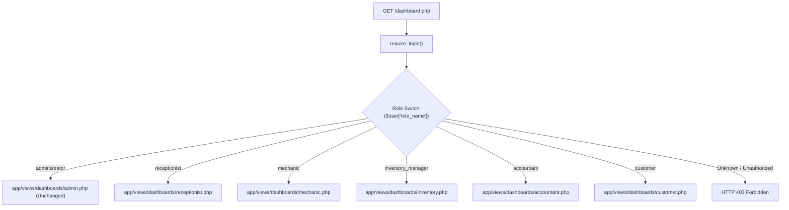

# ALPHA GARAGE — PHASE 1.10: DASHBOARD DESIGN SPECIFICATION
## Visual Identity, Layout Architecture, and User Experience for Role-Specific Dashboards

**Document Version:** 1.0.0  
**Phase:** 1.10  
**Design Theme:** Luxury Dark Automotive (Emerald `#0B2E1B`, Forest `#163826`, Gold `#D4AF37`)  
**Architecture:** Server-rendered PHP, Semantic HTML5, Vanilla JavaScript, CSS custom properties  

---

## 1. Visual Identity & Design Principles

ALPHA GARAGE employs a dark luxury automotive aesthetic reflecting high-end European tuning and engineering precision.

### Color Palette & Tokens
- **Background Root:** `#0B2E1B` / `#081E12` (Deep Forest Black)
- **Card Background:** `#133823` with subtle border `#1F4D32`
- **Accent Primary (Gold):** `#D4AF37` / `#B38D16` (Metallic Gold)
- **Status Ok:** `#16834A` / `#22C55E` (Emerald Green)
- **Status Warn:** `#B38D16` / `#EAB308` (Amber Gold)
- **Status Danger:** `#DC2626` / `#EF4444` (Racing Red)
- **Status Info / Blue:** `#245D49` / `#3B82F6` (Electric Slate)
- **Typography:** Inter / system sans-serif, high legibility, strict contrast compliance (>4.5:1).

---

## 2. Dashboard Layout Architecture

### Role-Based Dispatcher (`public/dashboard.php`)
The central entrypoint executes server-side authentication (`require_login()`), inspects `$user['role_name']`, and securely includes the appropriate dedicated view from `app/views/dashboards/`:

---

## 3. Detailed UI Design for Each Non-Admin Role

### 3.1 Receptionist Dashboard (`app/views/dashboards/receptionist.php`)
- **Hero Banner:** Welcome Receptionist · Front Desk Operations & Vehicle Intake.
- **KPI Metrics (4 Cards):**
  1. *Total Customers:* Active registered customers count.
  2. *Total Vehicles:* Registered vehicle fleet count.
  3. *Today's Appointments:* Today's scheduled visits (with pending/confirmed breakdown).
  4. *Active Job Cards:* Open jobs currently in workshop (Pending, Diagnosing, In Progress).
- **Fast Action Toolbar:**
  - `+ New Appointment` (`/appointments/form.php`)
  - `+ New Job Card` (`/job-cards/form.php`)
  - `+ Register Customer` (`/customers/form.php`)
  - `+ Register Vehicle` (`/vehicles/form.php`)
- **Data Sections:**
  - *Today's Schedule & Appointments Table:* Time, Customer, Vehicle, Service requested, Status, and Action link.
  - *Active Workshop Job Cards Table:* Job #, Customer, Vehicle, Status badge, Assigned Mechanic, Date Received.
  - *Quick Search & Recent Customers List:* Quick intake and lookup.

### 3.2 Mechanic Dashboard (`app/views/dashboards/mechanic.php`)
- **Hero Banner:** Welcome Mechanic · Assigned Vehicle Workstation.
- **KPI Metrics (3 Cards - Strictly Scoped to Mechanic ID):**
  1. *Active Assigned Jobs:* Jobs assigned to me in progress or diagnosing.
  2. *Priority / Urgent Jobs:* High or urgent priority jobs needing immediate attention.
  3. *Completed Jobs:* Total completed repairs by this mechanic.
- **Data Sections:**
  - *My Active Repair Queue:* Job Card Number, Priority Badge (Urgent in Red, High in Amber), Vehicle details (Plate, Make, Model, Year), Reported Problem, Diagnosis notes, Current Status, Action buttons (`View Details`, `Update Status`).
  - *Recent Completed Work:* History of recently completed jobs.
  - *Quick Part Request Shortcut:* Seamless link to request parts for active jobs.
- **Security Guard:** Only jobs matching `$user['mechanic_id']` are retrieved. A mechanic assigned to zero jobs receives an encouraging clean empty state.

### 3.3 Inventory Manager Dashboard (`app/views/dashboards/inventory.php`)
- **Hero Banner:** Welcome Inventory Manager · Parts Catalog & Stock Control.
- **KPI Metrics (4 Cards):**
  1. *Total Catalog Items:* Total spare part SKU types.
  2. *Low Stock Alerts:* Items with quantity <= reorder_level.
  3. *Out of Stock:* Items with 0 quantity on hand.
  4. *Active Suppliers:* Number of registered parts suppliers.
- **Fast Action Toolbar:**
  - `+ Add Spare Part` (`/inventory/form.php`)
  - `Adjust Stock / In` (`/inventory/adjust.php`)
  - `Issue Parts` (`/inventory/issue.php`)
  - `Suppliers` (`/suppliers/`)
- **Data Sections:**
  - *Critical Restock Alerts Table:* SKU, Part Name, Category, Stock Level, Reorder Level, Status Badge, Quick Reorder link.
  - *Recent Stock Movements Table:* Date, Part, Transaction Type (Purchase, Issue, Return, Adjustment), Quantity, Reference.
  - *Open Job Cards Needing Parts Table:* Open jobs for easy part issuing.
- **Zero Financial Disclosure:** Does not query or display customer invoices, total garage revenue, or net profit.

### 3.4 Accountant Dashboard (`app/views/dashboards/accountant.php`)
- **Hero Banner:** Welcome Accountant · Financial Management & Ledger Control.
- **KPI Metrics (4 Cards):**
  1. *Total Invoiced ($):* Total value of all issued invoices.
  2. *Total Payments Collected ($):* Total completed cash/card/transfer receipts.
  3. *Outstanding Balance ($):* Total unpaid / partially paid invoice balances.
  4. *Total Recorded Expenses ($):* Total operating expenses recorded in ledger.
- **Fast Action Toolbar:**
  - `+ Record Payment` (`/payments/record.php`)
  - `+ Record Expense` (`/expenses/`)
  - `Financial Reports` (`/reports/financial.php`)
  - `Unpaid Invoices` (`/invoices/?status=outstanding`)
- **Data Sections:**
  - *Outstanding Invoices Aging Ledger:* Invoice #, Issue Date, Customer, Total Amount, Paid, Balance Due, Status Badge, Action: Record Payment.
  - *Recent Payments Ledger:* Receipt #, Invoice #, Date, Method, Amount, Action: View Receipt.
  - *Recent Expenses Table:* Date, Category, Vendor, Amount, Description.

### 3.5 Customer Portal Dashboard (`app/views/dashboards/customer.php`)
- **Header Navigation:** Luxury Public Portal Navigation (`Home`, `Services`, `Contact`, `Book Service`, `Account`, `Sign Out`).
- **Hero Banner:** Welcome, [Customer Full Name] · Your Vehicle Service Portal.
- **KPI Metrics (4 Cards - Scoped Strictly to Customer Account):**
  1. *My Registered Vehicles:* Count of customer's vehicles.
  2. *Upcoming Appointments:* Scheduled service visits.
  3. *Active Repairs:* Job cards currently in progress for their vehicles.
  4. *Pending Invoices:* Invoices with an outstanding balance.
- **Action Button:** `+ Book New Appointment` (`/book.php`).
- **Data Sections:**
  - *My Vehicles Fleet:* Plate, Make, Model, Year, Fuel Type, Quick "Book Service" button per vehicle.
  - *My Service Appointments:* Appointment #, Scheduled Date, Time, Vehicle, Service Name, Status badge.
  - *Live Repair Status (Active Job Cards):* Job #, Date Received, Vehicle, Progress Stage (Pending, Diagnosing, In Progress, Completed), Problem Description.
  - *My Invoices & Receipts:* Invoice #, Date, Vehicle, Total, Amount Paid, Balance Due, Payment Status badge.
- **Strict Data Isolation:** All database queries enforce `customer_id = $customerId`. Zero cross-customer data leakage.
