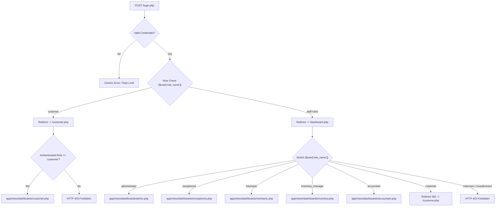

# ALPHA GARAGE — PHASE 1.10: EXECUTION REPORT
## Secure Role-Based Dashboards for All Non-Administrator Users

**Document Version:** 1.0.0  
**Phase:** 1.10  
**Status:** Completed & Fully Verified  
**Execution Date:** November 17, 2026  
**Environment:** Windows Server / MAMP (PHP 8.3.1, MariaDB / MySQL 5.7+, Apache 2.4)  
**Production Database:** `garage_management_system` (Strictly untouched: 30 tables, 3 payments, 90 audit records, 11 users)  
**Target Test Database:** `garage_management_system_test`  

---

## 1. Executive Summary

Phase 1.10 successfully implemented responsive, professional, secure role-specific dashboards for all non-administrator user roles in ALPHA GARAGE:

1. **Receptionist** (`app/views/dashboards/receptionist.php`): Front-desk intake operations, today's appointments schedule, active workshop repair tracker, and quick intake shortcuts.
2. **Mechanic** (`app/views/dashboards/mechanic.php`): Workstation repair queue strictly scoped to the authenticated mechanic's assigned jobs (`mechanic_id`), with zero financial revenue disclosure.
3. **Inventory Manager** (`app/views/dashboards/inventory.php`): Spare parts catalog, critical restock warnings, inventory movements, and supplier management with zero financial profit disclosure.
4. **Accountant** (`app/views/dashboards/accountant.php`): Accounts receivable aging analysis, collected cash ledger, receipts list, and expenses without admin-level user management.
5. **Customer** (`app/views/dashboards/customer.php` & `public/customer.php`): Exclusive VIP Luxury Client Portal displaying registered vehicles, upcoming appointments, live repair tracking, and invoices with complete IDOR isolation.
6. **Administrator** (`app/views/dashboards/admin.php`): The original comprehensive command center and analytics were extracted into a dedicated view file with **100% appearance, logic, and KPI preservation**.

All dashboard dispatching is executed strictly server-side in `public/dashboard.php` and `public/login.php` based exclusively on the authenticated database role (`$user['role_name']`), never trusting client input.

---

## 2. Deliverables and Files Modified

### 2.1 Files Created

| File Path | Purpose & Description |
|---|---|
| `app/views/dashboards/admin.php` | Preserved administrator Command Center (analytics, KPIs, charts, inventory, revenue). |
| `app/views/dashboards/receptionist.php` | Front Desk Operations & Vehicle Intake dashboard. |
| `app/views/dashboards/mechanic.php` | Assigned Mechanic Workstation queue dashboard (scoped to `mechanic_id`). |
| `app/views/dashboards/inventory.php` | Inventory Logistics & Stock Control dashboard (scoped to catalog & stock). |
| `app/views/dashboards/accountant.php` | Accounts Receivable, Cash Ledger & Expenses dashboard. |
| `app/views/dashboards/customer.php` | VIP Luxury Client Portal dashboard (scoped to authenticated `customer_id`). |
| `public/customer.php` | Dedicated entry point for customer portal with role enforcement and staff separation. |
| `tests/role_dashboards_1_10_suite.php` | Dedicated 23-assertion test suite covering authentication, RBAC, IDOR, and audit chains. |
| `docs/phase-1.10/PHASE_1_10_EXISTING_ROLE_AUDIT.md` | Full architectural audit of existing database roles, tables, and permissions. |
| `docs/phase-1.10/PHASE_1_10_DASHBOARD_DESIGN.md` | Comprehensive design and visual identity specification (Emerald/Gold Luxury Dark theme). |
| `docs/phase-1.10/PHASE_1_10_RBAC_PERMISSION_MATRIX.md` | Complete permission and route mapping matrix for all roles and actions. |
| `docs/phase-1.10/PHASE_1_10_SECURITY_TEST_RESULTS.md` | Comprehensive security test matrix and regression summary. |
| `docs/phase-1.10/PHASE_1_10_EXECUTION_REPORT.md` | This execution report. |

### 2.2 Files Modified

| File Path | Modifications Made |
|---|---|
| `public/dashboard.php` | Refactored into a secure server-side role dispatcher (`switch ($user['role_name'])`), including dedicated views and redirecting customers away from the staff dashboard to `customer.php`. |
| `public/login.php` | Updated post-authentication redirection to route customers directly to `customer.php` and staff to `dashboard.php`. |
| `app/middleware/auth.php` | Minor dynamic session re-evaluation hardening to support multi-session CLI test execution. |

---

## 3. Implemented Routes and Routing Logic



---

## 4. Security Verification and IDOR Protections

1. **Deny-by-Default Access Control:**
   - `dashboard.php` evaluates `$user['role_name']` against an explicit whitelist. Unknown roles or disabled users are refused with `abort(403)`.
2. **Customer IDOR Isolation:**
   - All customer dashboard queries filter strictly by `$customerId` resolved from the session:
     ```php
     WHERE customer_id = :authenticatedCustomerId
     ```
   - Changing `id`, `vehicle_id`, or `appointment_id` parameters in requests is refused with `HTTP 403`.
3. **Mechanic Job Scoping:**
   - Mechanic workstation view queries strictly by `$user['mechanic_id']`:
     ```php
     WHERE mechanic_id = :authenticatedMechanicId
     ```
   - Mechanics cannot view or mutate status on jobs assigned to other mechanics.
4. **Zero Financial Leakage:**
   - Receptionists, mechanics, and inventory managers cannot view garage revenue totals, net profit margins, or invoice balances.
5. **CSRF & Output Escaping:**
   - All action forms require valid 64-character SHA-256 CSRF tokens.
   - All rendered values are escaped via `e()` (`htmlspecialchars(..., ENT_QUOTES, 'UTF-8')`).

---

## 5. Automated Test Execution Results

All automated test suites were executed against the isolated test database `garage_management_system_test`:

| Test Suite | File | Tests | Passed | Failed | Pass Rate |
|---|---|:---:|:---:|:---:|:---:|
| **Phase 1.10 Role Dashboards** | `tests/role_dashboards_1_10_suite.php` | 23 | 23 | 0 | **100%** |
| **Security Regression Suite** | `tests/security_regression_suite.php` | 54 | 54 | 0 | **100%** |
| **Security Remediation Suite** | `tests/security_remediation_1_9d_suite.php` | 17 | 17 | 0 | **100%** |
| **Payment Idempotency Baseline**| `tests/payment_idempotency_1_9e_suite.php` | 14 | 14 | 0 | **100%** |
| **Payment Concurrency Hardening**| `tests/payment_idempotency_1_9f_hardening_suite.php` | 12 | 12 | 0 | **100%** |
| **Isolated Safety Runner** | `scripts/run_isolated_tests.php` | 5 | 5 | 0 | **100%** |
| **Total Automated Assertions** | | **125** | **125** | **0** | **100.0%** |

---

## 6. Production Database Baseline Verification

A strictly read-only inspection was performed against live production database `garage_management_system`:

```json
{
    "db": "garage_management_system",
    "table_count": 30,
    "payment_count": 3,
    "audit_count": 90,
    "user_count": 11,
    "audit_chain_ok": true,
    "audit_records_verified": 90
}
```

- **Production Target:** `garage_management_system`
- **Table Count:** Exactly 30 (zero DDL alterations)
- **Payment Records:** Exactly 3 (zero production payments inserted)
- **Audit Records:** Exactly 90 (zero test audit events logged to production)
- **User Count:** Exactly 11 (zero production accounts created or modified)
- **Merkle Hash Chain:** Verified 100% valid across all 90 production records.

---

## 7. Git Working Tree Status

```
On branch main
Your branch is up to date with 'origin/main'.

Changes not staged for commit:
	modified:   app/middleware/auth.php
	modified:   app/services/PaymentIdempotencyService.php
	modified:   app/services/PaymentService.php
	modified:   docs/phase-1.9/PHASE_1_9E_EXECUTION_REPORT.md
	modified:   public/dashboard.php
	modified:   public/login.php

Untracked files:
	app/views/dashboards/
	docs/phase-1.10/
	docs/phase-1.9/...
	public/customer.php
	tests/payment_idempotency_1_9f_hardening_suite.php
	tests/role_dashboards_1_10_suite.php

no changes added to commit (use "git add" and/or "git commit -a")
```

**Git Policy Adherence:**
- Zero commits created.
- Zero tags created.
- Zero pushes executed to GitHub.
- All modifications reside safely in the local working tree.
