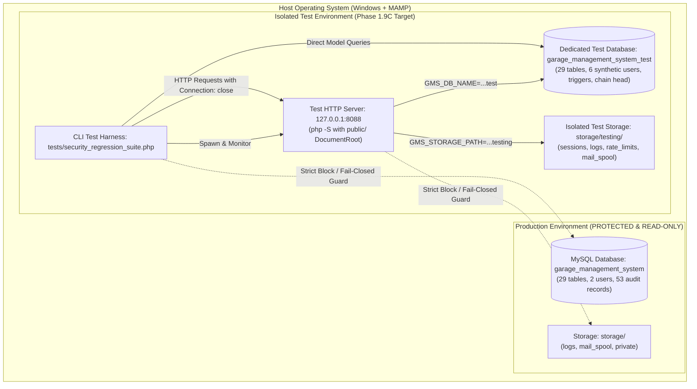

# ALPHA GARAGE — PHASE 1.9C: CORE SECURITY & AUTHENTICATION REGRESSION TEST PLAN

## 1. Executive Summary & Objective

The objective of **Phase 1.9C** is to design, implement, and execute a comprehensive security and authentication regression test suite for the ALPHA GARAGE Management System. Building on the isolated test environment provisioned in Phase 1.9B, this regression test plan covers 54 distinct automated test cases across seven mission-critical security domains:

1. **Domain A: Authentication** (10 test cases)
2. **Domain B: Authorization & Role-Based Access Control (RBAC)** (10 test cases)
3. **Domain C: Session Security & Lifetime Management** (6 test cases)
4. **Domain D: CSRF Protection & Request Method Security** (6 test cases)
5. **Domain E: Password & Account Recovery Security** (8 test cases)
6. **Domain F: Input Validation & Application Security** (7 test cases)
7. **Domain G: Audit Logging, Chain Integrity & Immutability** (7 test cases)

In addition to the 54 regression tests, the plan re-verifies the 4 existing unit and safety suites (`tests/auth_unit.php`, `tests/inventory_unit.php`, `tests/security_hardening_unit.php`, and `tests/safety_validation.php`) alongside cryptographic audit chain and trigger integrity.

---

## 2. Test Environment & Isolation Architecture

All tests execute strictly under the isolation boundaries established in Phase 1.9B:

| Boundary Dimension | Specification | Verification Mechanism |
|---|---|---|
| **Target Database** | `garage_management_system_test` | Strict preflight check (`SELECT DATABASE()`), fail-closed exit code 2 if production database `garage_management_system` is detected. |
| **Storage Directory** | `storage/testing/` | `storage_path()` runtime redirection; strict equality check preventing access to production `storage/`. |
| **Session Isolation** | Cookie: `GMSSESSID_TEST`<br>Path: `storage/testing/sessions/` | Hardened session configuration in `app/bootstrap.php` preventing collision with production `GMSSESSID`. |
| **Isolated Web Server** | PHP 8.3 Built-in Server on `127.0.0.1:8088`<br>DocumentRoot: `public/` | Dedicated server process spawned via `proc_open` with isolated environment variables (`GMS_TEST_MODE=1`, `GMS_STORAGE_PATH=...`, `GMS_DB_NAME=...`). Standard output/error redirected to `storage/testing/logs/test-server.log`. |
| **Production Protection** | Zero writes, zero mutations, zero schema changes | Read-only verification before and after execution confirming `garage_management_system` remains untouched. |



---

## 3. Test Catalog by Domain

### Domain A: Authentication (AUTH-01 – AUTH-10)
Focuses on authentication success, invalid credentials, account deactivation, account lockout, session rotation, fixation defenses, and HTTP method enforcement on logout.

- **AUTH-01:** Valid administrator authentication redirects with HTTP 302 to `/dashboard.php`.
- **AUTH-02:** Administrator authenticates using verified primary email address.
- **AUTH-03:** Non-existent username rejected with generic message `"Invalid username or password."`.
- **AUTH-04:** Valid username with wrong password rejected with identical generic message.
- **AUTH-05:** Inactive account (`is_active = 0`) rejected immediately at login without session generation.
- **AUTH-06:** Account lockout triggered after 5 consecutive failed attempts; subsequent attempts refused.
- **AUTH-07:** Session ID regenerates immediately upon successful authentication (`session_regenerate_id(true)`).
- **AUTH-08:** Pre-session fixation attempts neutralized; pre-set session cookie discarded on authentication.
- **AUTH-09:** POST logout terminates session, destroys session storage, and clears authentication state.
- **AUTH-10:** GET request to `/logout.php` refused with HTTP 405 Method Not Allowed.

### Domain B: Authorization & Role-Based Access Control (RBAC-01 – RBAC-10)
Verifies least privilege enforcement across all defined application roles, route protection, object-level access control (IDOR), and server-side privilege escalation resistance.

- **RBAC-01:** Administrator has full authorized access to core modules (`/dashboard.php`, `/users/`, `/audit-logs/`, `/invoices/`, `/reports/`, `/expenses/`).
- **RBAC-02:** Receptionist role accesses designated operational routes (`/customers/`, `/vehicles/`, `/job-cards/`, `/invoices/`, `/payments/`).
- **RBAC-03:** Receptionist blocked with HTTP 403 from administrative routes (`/audit-logs/`, `/users/`, `/expenses/`).
- **RBAC-04:** Mechanic role accesses designated workboard (`/job-cards/`).
- **RBAC-05:** Mechanic blocked with HTTP 403 from financial and customer routes (`/invoices/`, `/customers/`, `/payments/`, `/users/`).
- **RBAC-06:** Inventory Manager accesses stock (`/inventory/`) but blocked from `/payments/record.php` and `/users/`.
- **RBAC-07:** Accountant accesses `/expenses/` and `/invoices/` but blocked from `/audit-logs/` and `/reports/?report=audit`.
- **RBAC-08:** Customer role has zero staff dashboard access; restricted from administrative operational routes.
- **RBAC-09:** Insecure Direct Object Reference (IDOR) defense: mechanic assigned to Job Card #1 cannot access Job Card #2 assigned to another mechanic.
- **RBAC-10:** Privilege escalation defense: unprivileged user attempting POST mutation on administrative endpoint is rejected server-side with HTTP 403.

### Domain C: Session Security (SESS-01 – SESS-06)
Validates cookie attributes, transport encryption flags, session storage isolation, idle timeout, and PHP runtime session mode.

- **SESS-01:** Session cookie enforces `HttpOnly` flag to prevent script access.
- **SESS-02:** Session cookie enforces `SameSite=Lax` policy against cross-site request forgery.
- **SESS-03:** Session cookie applies `Secure` flag dynamically when accessed under HTTPS.
- **SESS-04:** Dedicated cookie name `GMSSESSID_TEST` strictly enforced in test runtime.
- **SESS-05:** Expired idle session (> 4 hours of inactivity) is invalidated automatically upon next request.
- **SESS-06:** Strict session mode (`session.use_strict_mode = 1`) and cookie-only storage (`session.use_only_cookies = 1`) enforced.

### Domain D: CSRF & Request Security (CSRF-01 – CSRF-06)
Evaluates cryptographic token validation, anti-replay lifetime boundaries, missing/forged token handling, and audit trail logging of CSRF rejections.

- **CSRF-01:** Authentic CSRF token accepted; form state mutation succeeds with HTTP 302 redirect.
- **CSRF-02:** POST request lacking CSRF token rejected with HTTP 419.
- **CSRF-03:** Forged / modified CSRF token rejected with HTTP 419.
- **CSRF-04:** Expired CSRF token (> 7200 seconds / 2 hours) rejected by `csrf_token_is_valid()`.
- **CSRF-05:** CSRF validation failures logged to `audit_logs` with `action_type = 'csrf_validation_failed'` and `action_result = 'denied'`.
- **CSRF-06:** State mutation requests require HTTP POST; GET mutations rejected or disallowed.

### Domain E: Password & Account Recovery (RECOV-01 – RECOV-08)
Verifies password hashing algorithms, anti-enumeration behavior, token hashing, expiration, replay prevention, complexity policies, and secret redaction.

- **RECOV-01:** All stored user password hashes use modern bcrypt (`$2y$`) or argon2. Zero plain-text or weak hashes.
- **RECOV-02:** Password reset requests return generic confirmation message regardless of whether the email exists (anti-enumeration).
- **RECOV-03:** Password reset tokens stored exclusively as SHA-256 hashes in database; raw token never persisted.
- **RECOV-04:** Random or malformed reset tokens rejected by `PasswordResetService::validateToken()`.
- **RECOV-05:** Expired reset tokens (`expires_at < NOW()`) rejected.
- **RECOV-06:** Password reset tokens strictly single-use; token consumed and invalidated immediately upon password update.
- **RECOV-07:** Password complexity policy enforced via `AuthService::passwordProblems()`: length (>= 10), uppercase, lowercase, numbers, symbols, and username dissimilarity.
- **RECOV-08:** Audit logs contain zero passwords, raw hashes, or password reset tokens (all redacted via `AuditLogger::redact()`).

### Domain F: Input & Application Security (INP-01 – INP-07)
Validates SQL injection resistance across multiple entry points, Cross-Site Scripting (XSS) output escaping, timing attack mitigation, debug suppression, and path traversal defense.

- **INP-01:** SQL injection payload (`' OR '1'='1' -- `) in search parameter handled safely by prepared statements; zero data leak.
- **INP-02:** UNION SQL injection payload (`x%' UNION SELECT ...`) executed without syntax errors or data disclosure.
- **INP-03:** SQL injection payload in login credentials handled securely without authentication bypass.
- **INP-04:** User input containing HTML / JavaScript tags (`<script>alert("XSS")</script>`) is escaped via `e()` (`htmlspecialchars`) when rendered.
- **INP-05:** Authentication failure response message strictly identical between existing and non-existing accounts.
- **INP-06:** Application debug mode disabled (`debug = false`); fatal stack traces and internals suppressed from HTTP output.
- **INP-07:** `storage_path()` strictly rejects path traversal attempts (`..` segments) with `InvalidArgumentException`.

### Domain G: Audit Logging & Immutability (AUD-01 – AUD-07)
Evaluates audit event capture, cryptographic tamper detection, row hash sensitivity, and database engine-level append-only triggers.

- **AUD-01:** Successful authentication recorded in `audit_logs` with `action_type = 'login_success'`, actor details, and IP address.
- **AUD-02:** Failed authentication attempts recorded with `action_type = 'login_failed'`, username, and failure result.
- **AUD-03:** Rate-limiting lockout events recorded with `action_type = 'login_blocked_rate_limit'` and `action_result = 'denied'`.
- **AUD-04:** Authorization rejections (HTTP 403) recorded with `action_type = 'authorization_denied'` and attempted action.
- **AUD-05:** Cryptographic SHA-256 hash chain verified intact across all audit records via `AuditLogger::verifyChain()`.
- **AUD-06:** Cryptographic tamper simulation: altering any field in an audit record mathematically invalidates `row_hash`.
- **AUD-07:** Database engine triggers (`trg_audit_no_update`, `trg_audit_no_delete`) block direct SQL `UPDATE` and `DELETE` queries on `audit_logs`.

---

## 4. Execution Methodology

```
┌──────────────────────────────────────────────────────────────────┐
│  Phase 1.9C Execution Sequence                                  │
├──────────────────────────────────────────────────────────────────┤
│ 1. Preflight Safety Assertion (Storage Guard, DB Guard)          │
│ 2. Isolated Web Server Spawn (Port 8088, public/ DocumentRoot)   │
│ 3. Automated Test Execution (Domains A -> G, 54 Tests)          │
│ 4. Child Server Termination & Cookie Jar Cleanup                 │
│ 5. JSON Test Report Generation (storage/testing/)                │
│ 6. Existing Unit Suites Re-execution (5 suites via runner)       │
│ 7. Production Database & Storage Zero-Mutation Verification      │
└──────────────────────────────────────────────────────────────────┘
```

The test runner handles HTTP keep-alive behavior on the single-threaded PHP built-in web server by configuring cURL with `Connection: close`, `CURLOPT_FORBID_REUSE => true`, and `CURLOPT_FRESH_CONNECT => true`.
