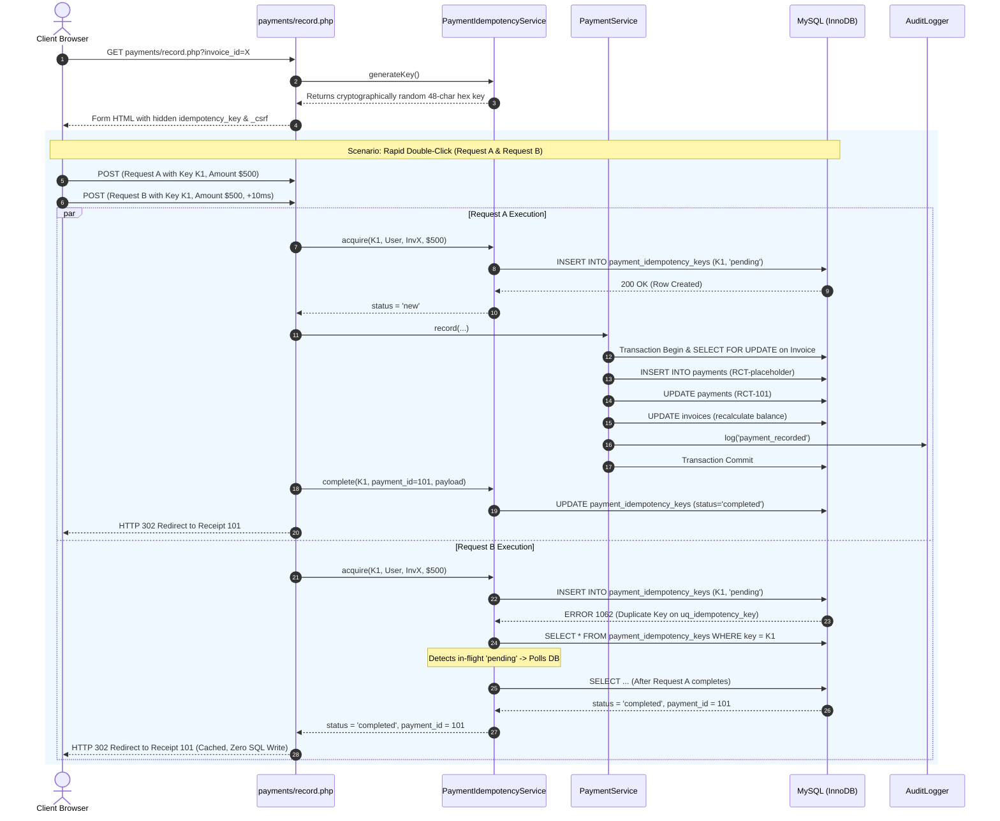

# ALPHA GARAGE — PHASE 1.9E: PAYMENT SYSTEM ARCHITECTURE AUDIT
## Read-Only Architectural Inspection & Vulnerability Assessment

**System:** ALPHA GARAGE Management System  
**Phase:** 1.9E — Payment Idempotency & Duplicate Payment Protection  
**Target Repository:** `ALPHA-GARAGE` (Branch: `main`, Baseline Commit: `b4e2a54`)  
**Environment:** PHP 8.3.1, MySQL 5.7.24 (MAMP Windows), Apache 2.4.33  
**Status:** Read-Only Inspection Complete  
**Date:** November 17, 2026  

---

## 1. Executive Summary & Objective

Prior to Phase 1.9E, the ALPHA GARAGE management system possessed robust relational integrity, append-only cryptographic audit logging, and role-based access control. However, financial transaction handling lacked an atomic, database-enforced idempotency mechanism. 

This audit presents a comprehensive, read-only architectural inspection of the payment, invoice, and financial ledger subsystems. It identifies the exact mechanisms governing payment insertion, invoice balance recalculation, trigger behavior, and transaction boundaries, and systematically catalogs all vulnerabilities allowing duplicate payment credits.

---

## 2. In-Depth Component Inspection

### 2.1 Payment Database Schema (`payments`)

The `payments` table (`database/database.sql:356-373`) stores commercial payment and refund records:

```sql
CREATE TABLE payments (
  id INT UNSIGNED AUTO_INCREMENT PRIMARY KEY,
  receipt_number VARCHAR(30) NOT NULL UNIQUE,
  invoice_id INT UNSIGNED NOT NULL,
  kind ENUM('payment','refund') NOT NULL DEFAULT 'payment',
  amount DECIMAL(12,2) NOT NULL,
  method VARCHAR(40) NOT NULL,
  reference VARCHAR(80) NULL,
  paid_at DATETIME NOT NULL,
  notes VARCHAR(255) NULL,
  recorded_by INT UNSIGNED NULL,
  created_at TIMESTAMP NOT NULL DEFAULT CURRENT_TIMESTAMP,
  CONSTRAINT fk_pay_inv FOREIGN KEY (invoice_id) REFERENCES invoices(id),
  CONSTRAINT fk_pay_user FOREIGN KEY (recorded_by) REFERENCES users(id) ON DELETE SET NULL,
  CONSTRAINT chk_pay_amount CHECK (amount > 0),
  INDEX idx_pay_invoice (invoice_id),
  INDEX idx_pay_date (paid_at)
) ENGINE=InnoDB;
```

**Key Architectural Observations:**
- `receipt_number`: Enforces uniqueness on receipt strings (`RCT-{id}` or `RFD-{id}`).
- `amount`: Constrained to positive values (`amount > 0`). Stored as `DECIMAL(12,2)`.
- **Absence of Idempotency Constraints:** In the baseline schema, the table has **no unique constraint on client request tokens, transaction hashes, or operation keys**. Any number of rows with identical `invoice_id`, `amount`, `method`, `reference`, and `paid_at` can be inserted without violating database constraints.

---

### 2.2 Invoice Database Schema (`invoices`)

The `invoices` table (`database/database.sql:310-330`) tracks client billing, payments, and balances:

```sql
CREATE TABLE invoices (
  id INT UNSIGNED AUTO_INCREMENT PRIMARY KEY,
  invoice_number VARCHAR(30) NOT NULL UNIQUE,
  job_card_id INT UNSIGNED NOT NULL UNIQUE,
  customer_id INT UNSIGNED NOT NULL,
  vehicle_id INT UNSIGNED NOT NULL,
  issue_date DATE NOT NULL,
  due_date DATE NULL,
  labor_total DECIMAL(12,2) NOT NULL DEFAULT 0.00,
  parts_total DECIMAL(12,2) NOT NULL DEFAULT 0.00,
  subtotal DECIMAL(12,2) NOT NULL DEFAULT 0.00,
  discount DECIMAL(12,2) NOT NULL DEFAULT 0.00,
  tax_rate DECIMAL(5,2) NOT NULL DEFAULT 0.00,
  tax_amount DECIMAL(12,2) NOT NULL DEFAULT 0.00,
  grand_total DECIMAL(12,2) NOT NULL DEFAULT 0.00,
  amount_paid DECIMAL(12,2) NOT NULL DEFAULT 0.00,
  balance DECIMAL(12,2) NOT NULL DEFAULT 0.00,
  payment_status ENUM('Unpaid','Partially Paid','Paid','Refunded') NOT NULL DEFAULT 'Unpaid',
  notes VARCHAR(500) NULL,
  created_by INT UNSIGNED NULL,
  created_at TIMESTAMP NOT NULL DEFAULT CURRENT_TIMESTAMP
) ENGINE=InnoDB;
```

**Key Architectural Observations:**
- Financial state (`amount_paid`, `balance`, `payment_status`) is denormalized and maintained synchronously by `InvoiceService::recalculate()`.
- Balances are computed in integer cents and converted back to decimal to prevent floating-point rounding errors.

---

### 2.3 Payment Controllers & Creation Endpoints

1. **`public/payments/record.php` (Payment Intake):**
   - Guards: `require_login()`, `require_permission('payments.record')`.
   - Method: POST with CSRF verification (`verify_csrf()`).
   - Action: Validates user input (`amount`, `method`, `reference`, `notes`) and delegates to `PaymentService::record()`.
   - Navigation: On success, redirects to `payments/receipt.php?id={pid}` via HTTP 302.

2. **`public/payments/refund.php` (Refund Intake):**
   - Guards: `require_login()`, `require_post()`, `require_permission('payments.refund')`.
   - Method: POST with CSRF verification (`verify_csrf()`).
   - Action: Validates reason and amount, delegating to `PaymentService::refund()`.

3. **`public/invoices/view.php` (Embedded Refund Form):**
   - Renders modal/inline refund form when user holds `payments.refund` and invoice has net paid balance (`$net['net'] > 0`).

---

### 2.4 Payment Services & Insertion Logic

In `PaymentService.php`:

```php
private static function insertRow(int $invoiceId, string $kind, int $cents, string $method, string $reference, string $notes): int
{
    $recordedBy = function_exists('current_user') ? (current_user()['id'] ?? null) : null;
    $id = Database::insert(
        'INSERT INTO payments (receipt_number, invoice_id, kind, amount, method, reference, paid_at, notes, recorded_by) VALUES (?,?,?,?,?,?,?,?,?)',
        [Numbering::placeholder(), $invoiceId, $kind, from_cents($cents), $method, $reference ?: null, date('Y-m-d H:i:s'), $notes ?: null, $recordedBy]
    );
    Database::run('UPDATE payments SET receipt_number = ? WHERE id = ?', [Numbering::make($kind === 'refund' ? 'RFD' : 'RCT', $id), $id]);
    return $id;
}
```

**Exact Insertion Sequence:**
1. A temporary placeholder receipt number is inserted with the payment row.
2. The auto-incremented primary key (`$id`) is obtained.
3. An `UPDATE` query establishes the permanent formatted receipt number (`RCT-{id}` or `RFD-{id}`).

---

### 2.5 Invoice Balance Calculations (`InvoiceService.php`)

Balance recalculation is strictly centralized in `InvoiceService::recalculate(int $id)`:

```php
public static function recalculate(int $id): array
{
    $inv = Database::one('SELECT * FROM invoices WHERE id = ?', [$id]);
    // 1. Calculate labor and parts totals from line items
    // ...
    // 2. Net payments calculation
    $p = self::netPaid($id);
    $balance = max(0, $t['grand'] - $p['net']);
    $status = self::statusFor($t['grand'], $p['net'], $p['refunded']);
    Database::run('UPDATE invoices SET labor_total=?, parts_total=?, subtotal=?, discount=?, tax_amount=?, grand_total=?, amount_paid=?, balance=?, payment_status=? WHERE id=?',
        [...]);
    return [...];
}
```

Where `netPaid()` sums all records from the `payments` table:
$$\text{Net Paid} = \sum_{kind=\text{'payment'}} \text{amount} - \sum_{kind=\text{'refund'}} \text{amount}$$
$$\text{Balance} = \max(0, \text{Grand Total} - \text{Net Paid})$$

**Vulnerability Impact:**
If two payments of \$500 are inserted for an invoice with a \$1,000 balance, `netPaid()` reads \$1,000 instead of \$500, setting `balance = 0.00` and `status = 'Paid'`. The customer is double-charged, and financial reporting shows \$1,000 collected instead of \$500.

---

### 2.6 Database Transaction Boundaries & Pessimistic Locking

In `PaymentService::record()`:

```php
$id = (int) Database::transaction(function () use ($invoiceId, $cents, $method, $reference, $notes) {
    $inv = InvoiceService::lock($invoiceId); // SELECT * FROM invoices WHERE id = ? FOR UPDATE
    if ($inv['payment_status'] === 'Refunded') { throw new DomainException('This invoice was fully refunded and is closed.'); }
    $balance = to_cents($inv['balance']);
    if ($cents > $balance) { throw new DomainException('The payment exceeds the outstanding balance.'); }
    $pid = self::insertRow($invoiceId, 'payment', $cents, $method, $reference, $notes);
    $t = InvoiceService::recalculate($invoiceId);
    AuditLogger::log('payment_recorded', 'payments', $pid, ...);
    return $pid;
});
```

**Transaction Analysis:**
1. `InvoiceService::lock($invoiceId)` executes `SELECT ... FOR UPDATE`, acquiring an exclusive row lock on the invoice in InnoDB.
2. If two requests execute sequentially or concurrently:
   - Request 1 locks Invoice 1.
   - Request 2 waits for the lock on Invoice 1.
   - Request 1 inserts payment, updates balance, logs audit, and commits. Lock is released.
   - Request 2 acquires the lock, re-reads the invoice.
   - **Crucial Weakness:** If the balance was \$2,000 and both requests were for \$500, Request 2 checks `if ($cents > $balance)` ($500 > $1,500), which is **FALSE**! Request 2 proceeds to insert a second payment of \$500, resulting in duplicate credit. Pessimistic row locking on the invoice protects against race conditions on balance over-deduction, but **does not prevent duplicate submissions when the outstanding balance exceeds the sum of the duplicates**.

---

### 2.7 Inspection of `trg_payments_immutable` Trigger

Inspection of `database/least_privilege.sql:52-64`:

```sql
DROP TRIGGER IF EXISTS trg_payments_immutable;
CREATE TRIGGER trg_payments_immutable BEFORE UPDATE ON payments
FOR EACH ROW
BEGIN
    IF NOT (
        OLD.amount <=> NEW.amount AND OLD.kind <=> NEW.kind AND OLD.invoice_id <=> NEW.invoice_id
        AND OLD.method <=> NEW.method AND OLD.reference <=> NEW.reference AND OLD.paid_at <=> NEW.paid_at
        AND OLD.notes <=> NEW.notes AND OLD.recorded_by <=> NEW.recorded_by
    ) THEN
        SIGNAL SQLSTATE '45000'
        SET MESSAGE_TEXT = 'payments are immutable: only receipt_number may be set after insert';
    END IF;
END;
```

**Critical Findings:**
1. **Trigger Event:** Strict `BEFORE UPDATE` on `payments`.
2. **Behavior on UPDATE:** Freezes all monetary and transaction fields. Permits changing `receipt_number` only (allowing the two-step insert/format pattern in `insertRow()`).
3. **Behavior on INSERT:** **The trigger exerts ZERO effect on INSERT operations**.
4. **Behavior on DELETE:** Not handled by trigger, but blocked by least-privilege SQL grants (only `SELECT`, `INSERT`, `UPDATE (receipt_number)` granted to `garage_app`).
5. **Conclusion:** The trigger guarantees immutability of recorded payments, but **does not prevent insertion of duplicate payment records**.

---

### 2.8 Audit Logging Subsystem (`AuditLogger.php`)

- Formats audit records with SHA-256 Merkle hash chain (`prev_hash`, `row_hash`).
- Serializes chain head appends via `SELECT last_hash FROM audit_chain_head WHERE id = 1 FOR UPDATE`.
- Joins the caller's active database transaction via `Database::transaction()`.
- **Rollback Behavior:** If the payment transaction rolls back, the audit record rolls back with it, leaving the hash chain strictly unbroken.

---

### 2.9 CSRF Implementation & Why It Fails for Idempotency

- `app/bootstrap.php` verifies CSRF for all POST requests.
- `csrf_field()` outputs a session-scoped token valid for 7200 seconds (2 hours).
- **Failure Mode:** CSRF tokens prevent cross-origin forgery; they do not enforce single-use semantics. When a user double-clicks or triggers browser form resubmission (F5), both requests carry the **identical valid CSRF token**. CSRF validation passes both times without hindrance.

---

### 2.10 Role-Based Access Control (RBAC)

- Roles: `administrator`, `receptionist`, `accountant`, `mechanic`, `inventory_manager`, `customer`.
- Permission `payments.record`: Held by `administrator`, `accountant`, `receptionist`.
- Permission `payments.refund`: Held by `administrator`, `accountant`.
- Permission checks occur at the controller boundary. An idempotency solution must respect these checks and prevent cross-user key hijacking.

---

## 3. Payment Lifecycle & Duplicate Submission Risks



### Risk Matrix Without Server-Side Idempotency

| Attack Vector / Failure Mode | Mechanism | Financial Impact | Technical Severity |
|---|---|---|---|
| **Rapid Double-Click** | User clicks submit button twice before UI disables | Duplicate payment row inserted; invoice credited twice | **HIGH** |
| **Browser Form Resubmit (F5)** | User refreshes page after payment; browser resends POST | Duplicate payment row inserted; invoice credited twice | **HIGH** |
| **Network Timeout Retry** | Gateway or client retries timed-out HTTP POST | Duplicate payment row inserted; invoice credited twice | **HIGH** |
| **Concurrent Requests** | Parallel curl/HTTP calls with identical CSRF | Race condition in payment insertion; ledger desynchronization | **CRITICAL** |
| **Parameter Tampering** | Reusing a key with altered amount or different invoice | Ledger distortion or key pollution across accounts | **HIGH** |
| **Cross-User Key Hijacking** | Malicious user passes another user's key | Unauthorized access to payment receipts or transaction blocking | **CRITICAL** |
| **Failed Transaction State** | Overpayment or DB error leaves key locked | Legitimate retry blocked; user locked out from paying invoice | **MEDIUM** |

---

## 4. Architectural Requirements for Idempotency Engine

To resolve all identified vulnerabilities without modifying the production database schema or breaking existing triggers, the idempotency architecture must satisfy the following invariants:

1. **Kernel-Level Uniqueness:** A dedicated table with `UNIQUE KEY (idempotency_key)` to enforce race-condition atomicity at the InnoDB storage engine level.
2. **Payload Fingerprinting:** A cryptographic SHA-256 digest over `user_id|invoice_id|operation|amount|method|reference` to reject modified requests attempting to recycle keys.
3. **Pessimistic Locking & Transaction Isolation:** Preserve existing `InvoiceService::lock()` row locks and `Database::transaction()` rollback semantics.
4. **Clean Retry on Failure:** When a transaction aborts (e.g., validation failure or database error), the idempotency record must transition to `failed` to allow subsequent legitimate retries with the same key.
5. **Ownership Enforcement:** Strict assertion that the requesting user matches the key's creator.

---

## 5. Audit Conclusion

The payment and invoice architecture of ALPHA GARAGE is cleanly designed with strict separation of concerns, native PDO transactions, and immutable audit logs. The lack of insert-level duplicate protection is completely remediable via a non-invasive, database-backed idempotency service (`PaymentIdempotencyService`) and dedicated key registry (`payment_idempotency_keys`).

Execution is safe to proceed to Phase 2 (Design) and Phase 3 (Implementation).
