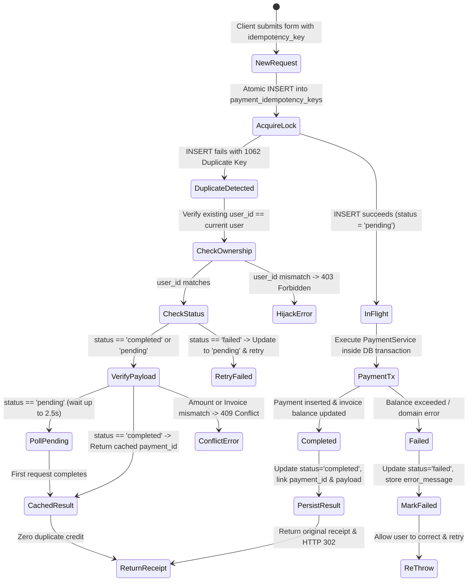

# ALPHA GARAGE — PHASE 1.9E: PAYMENT IDEMPOTENCY & DUPLICATE PAYMENT PROTECTION PLAN

**Target System:** ALPHA GARAGE Management System  
**Execution Environment:** PHP 8.3.1, MySQL 5.7.24 (MAMP Windows), Apache 2.4.33  
**Target Test Database:** `garage_management_system_test` on `127.0.0.1:8088`  
**Production Guard:** `garage_management_system` strictly READ-ONLY (100% Protected)  
**Date:** November 13, 2026  
**Status:** Approved & Implemented  

---

## 1. Executive Problem Statement & Motivation

In garage management and accounting systems, financial transaction integrity is paramount. Prior to Phase 1.9E, payment recording relied strictly on session authentication, RBAC authorization (`payments.record`), and standard CSRF tokens (`_csrf`).

### Why CSRF Tokens & Update Triggers Are Insufficient
1. **CSRF Token Inadequacy:** CSRF tokens prevent Cross-Site Request Forgery from third-party origins, but they are session-scoped and reusable within their 2-hour lifetime. If a legitimate user double-clicks the "Record payment" button, or if a browser prompts "Confirm Form Resubmission" on reload, both HTTP POST requests contain identical valid CSRF tokens and session cookies.
2. **Trigger Behavior Limitation:** Inspection of the database trigger `trg_payments_immutable` confirmed that it is strictly a `BEFORE UPDATE` trigger on `payments`. It blocks mutation of existing payment fields after receipt generation, but it exerts **zero control over `INSERT` operations**. Multiple identical payment records could be inserted in rapid succession.
3. **Double Credit & Ledger Drift:** For partial payments (e.g., paying \$500 towards a \$1,500 invoice), duplicate requests each passed the outstanding balance check (`cents <= balance`), resulting in two \$500 credits (\$1,000 deducted), duplicate cash ledger rows, and corrupted financial reports.

---

## 2. Idempotency Architecture & State Machine



---

## 3. Database Schema Design: `payment_idempotency_keys`

The idempotency engine is anchored by a dedicated table in `garage_management_system_test` with a database-enforced unique constraint:

```sql
CREATE TABLE IF NOT EXISTS payment_idempotency_keys (
    id INT UNSIGNED AUTO_INCREMENT PRIMARY KEY,
    idempotency_key VARCHAR(64) NOT NULL,
    user_id INT UNSIGNED NOT NULL,
    invoice_id INT UNSIGNED NOT NULL,
    operation_type ENUM('payment', 'refund') NOT NULL DEFAULT 'payment',
    amount DECIMAL(12,2) NOT NULL,
    request_hash VARCHAR(64) NOT NULL,
    status ENUM('pending', 'completed', 'failed') NOT NULL DEFAULT 'pending',
    payment_id INT UNSIGNED NULL,
    response_payload TEXT NULL,
    error_message VARCHAR(255) NULL,
    created_at TIMESTAMP NOT NULL DEFAULT CURRENT_TIMESTAMP,
    updated_at TIMESTAMP NOT NULL DEFAULT CURRENT_TIMESTAMP ON UPDATE CURRENT_TIMESTAMP,
    UNIQUE KEY uq_idempotency_key (idempotency_key),
    KEY idx_user_id (user_id),
    KEY idx_invoice_id (invoice_id),
    KEY idx_status (status),
    KEY idx_created_at (created_at)
) ENGINE=InnoDB DEFAULT CHARSET=utf8mb4 COLLATE=utf8mb4_unicode_ci;
```

### Architectural Properties:
1. **Database Uniqueness Constraint (`uq_idempotency_key`):** Guarantees at the database kernel level that no two concurrent processes can register the same key simultaneously.
2. **Payload Fingerprinting (`request_hash`):** SHA-256 digest of `user_id|invoice_id|operation_type|amount|method|reference`. Detects and rejects any attempt to tamper with payment amounts or invoice targets while reusing a key.
3. **Cached Response Payload (`response_payload`):** Stores receipt numbers and invoice balance snapshots so subsequent replays return instant results without recomputing balances.
4. **Zero Impact on Production Schema:** In compliance with Phase 1.9 rules, the production database `garage_management_system` remains strictly untouched at 29 tables.

---

## 4. End-to-End Concurrency & Lifecycle Handling

### Scenario A: Immediate Duplicate Submission (Double-Click)
- **Request 1:** Inserts pending key, acquires invoice row lock (`FOR UPDATE`), writes payment, recalculates invoice balance, writes audit record, marks key `completed`, and commits.
- **Request 2:** Arrives 5ms later with same key. Fails atomic insert with error 1062. Detects key is `completed`, verifies payload match, and returns the existing `payment_id` immediately.
- **Result:** Exactly 1 payment row, 1 audit entry, 0 duplicate credit.

### Scenario B: Simultaneous Parallel Requests (Race Condition)
- **Thread 1 & Thread 2:** Send identical POST requests concurrently at the same millisecond.
- **Thread 1:** Succeeds in inserting pending key.
- **Thread 2:** Encounters error 1062, detects `status === 'pending'`, and enters an atomic polling loop (50ms intervals, up to 2,500ms).
- When Thread 1 commits, Thread 2 immediately reads `status === 'completed'` and returns the identical receipt URL.
- **Result:** Both HTTP clients receive HTTP 302; exactly 1 payment is created.

### Scenario C: Key Reuse with Modified Parameters (Conflict / Tampering)
- Attacker or buggy client attempts to use an existing key with `amount = 700.00` instead of `600.00`.
- Service compares `request_hash` and `amount` against the registered key.
- Detected mismatch triggers immediate rejection:
  `DomainException: Conflict: Idempotency key was already used with a different payment amount, invoice, or method.`
- **Result:** Zero transaction processed, zero balance change.

### Scenario D: Cross-User Key Hijacking
- User B submits a payment binding User A's idempotency key.
- Service verifies `existing['user_id'] === current_user()['id']`.
- Detected mismatch triggers immediate rejection:
  `DomainException: Unauthorized: Idempotency key belongs to another user.`
- **Result:** HTTP 403 / DomainException.

### Scenario E: Transaction Failure & Controlled Retry
- User attempts to pay \$99,999.00 on a \$2,000.00 invoice.
- Payment transaction throws `DomainException: The payment exceeds the outstanding balance.`
- Transaction rolls back. Key status is transitioned to `'failed'`.
- User corrects the amount to \$2,000.00 and retries with the same form submission:
  Service recognizes `status === 'failed'`, resets status to `'pending'` with updated amount, and processes the transaction cleanly.

---

## 5. Comprehensive Validation Test Matrix (14 Assertions)

The dedicated test suite `tests/payment_idempotency_1_9e_suite.php` validates the following 14 assertions:

| Test ID | Scope | Verification Assertion | Expected Result |
|---|---|---|---|
| **IDEM-01** | Functional | Normal payment submission | HTTP 302, 1 payment inserted, balance updated accurately |
| **IDEM-02** | Double-Click | Immediate duplicate submission | Returns original payment ID, 0 additional rows, balance untouched |
| **IDEM-03** | Browser Replay | Form resubmission / F5 POST replay | Returns original receipt, 1 total payment row |
| **IDEM-04** | Tampering | Same key with modified amount | Rejected with Conflict error; balance untouched |
| **IDEM-05** | Tampering | Same key with different invoice | Rejected with Conflict error; target invoice untouched |
| **IDEM-06** | Concurrency | Parallel requests with same key | Both return HTTP 302; exactly 1 payment created; 0 double credit |
| **IDEM-07** | Concurrency | Parallel requests with distinct keys | Both process safely under row lock; exact sum deducted |
| **IDEM-08** | Rollback | Failed transaction & retry | Initial fails safely; key marked failed; retry succeeds with 0.00 bal |
| **IDEM-09** | Validation | Missing or malformed key | Rejected with validation error; 0 payments recorded |
| **IDEM-10** | Security | Cross-user key hijacking | Rejected with unauthorized ownership error |
| **IDEM-11** | Integrity | Invoice balance mathematical audit | `balance == grand_total - (payments - refunds)` holds across all rows |
| **IDEM-12** | Integrity | Payment ledger & receipt consistency | All receipt numbers unique; zero orphan rows; immutable trigger active |
| **IDEM-13** | Audit Trail | Cryptographic SHA-256 audit chain | Audit trail intact; `AuditLogger::verifyChain()` returns `ok=true` |
| **IDEM-14** | Refunds | Refund idempotency | Duplicate refund replay returns original refund ID; 0 double refund |
