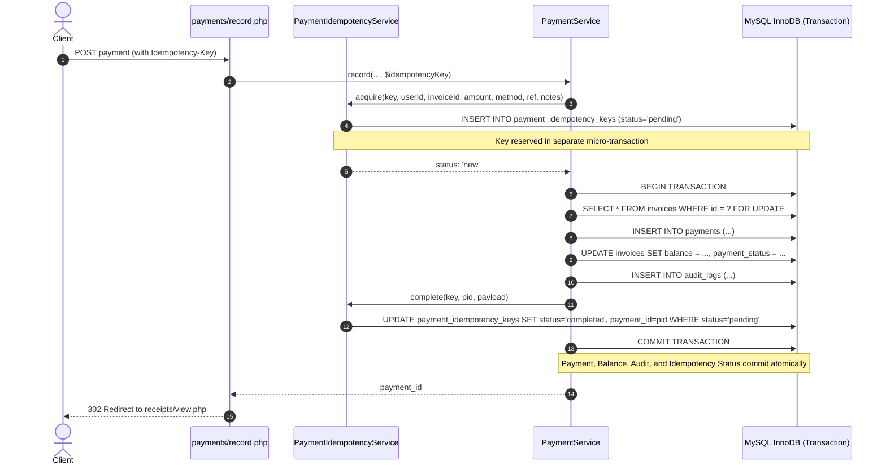

# ALPHA GARAGE — PHASE 1.9F: CRASH RECOVERY ANALYSIS
## Transaction Boundaries, Failure Modes, and State Consistency

**Document Version:** 1.0.0  
**Phase:** 1.9F  
**Target Systems:** Windows + MAMP (PHP 8.3, MySQL InnoDB)  
**Database Engines Evaluated:** MySQL 5.7 / MariaDB (ACID InnoDB)  

---

## 1. Architectural Transaction Boundary Inspection

In Phase 1.9E, the payment processing lifecycle was split into two sequential database operations:
1. `Database::transaction`: Insert payment, recalculate invoice, append audit log entry, and commit.
2. Separate query: Update `payment_idempotency_keys` status to `completed`.

This split created a finite crash window: if the PHP process was killed, Apache restarted, or the database connection broke between Step 1 and Step 2, the financial payment committed to the ledger while the idempotency key remained permanently in the `pending` state.

### Phase 1.9F Unified Transaction Boundary

In Phase 1.9F, the transaction boundary in `PaymentService::record` and `PaymentService::refund` was restructured so that idempotency completion is encapsulated **inside** the atomic transaction closure:



---

## 2. Crash Scenario Evaluation & Recovery Proofs

### Scenario A: Process Terminates Before Financial Commit
- **Point of Failure:** Process crashes while executing invoice calculation or before `COMMIT`.
- **Database Behavior:** The active InnoDB transaction is automatically rolled back by the MySQL server upon socket termination.
  - No row in `payments` is persisted.
  - The `invoices` balance and status remain unchanged.
  - No `audit_logs` entry is written.
- **Idempotency Key State:** The key row in `payment_idempotency_keys` remains `pending` (or transitions to `failed` via `PaymentIdempotencyService::fail` if caught by an error handler).
- **Recovery:** A retry from the client cleanly reclaims the failed key via atomic conditional acquisition (`WHERE idempotency_key = ? AND status = 'failed'`).
- **Financial Integrity Result:** Zero duplicate payments. Zero financial ledger discrepancy.

### Scenario B: Process Terminates During or After Commit
- **Point of Failure:** The database executes `COMMIT`, and the process terminates before sending the HTTP response to the client.
- **Database Behavior:** The redo log write is durable. All four mutations committed together:
  - `payments` row exists with unique receipt number.
  - `invoices` balance accurately reflects deduction.
  - `audit_logs` record is permanently chained.
  - `payment_idempotency_keys` has `status = 'completed'` and contains the exact `payment_id`.
- **Recovery:** The client (browser, mobile app, or webhook) times out and retries with the identical idempotency key.
  - The retry enters `PaymentIdempotencyService::acquire()`.
  - The service finds the key already marked `status = 'completed'`.
  - It validates the user ownership and request fingerprint.
  - It returns `['status' => 'completed', 'payment_id' => ...]`.
  - The controller immediately issues a `302 Redirect` to the existing receipt.
- **Financial Integrity Result:** Zero second payment. No double-debit. 100% idempotent replay.

### Scenario C: Database Connection Drops During Commit
- **Point of Failure:** Network disruption occurs precisely when the `COMMIT` packet is transmitted.
- **Database Behavior:** By MySQL InnoDB ACID guarantees, the transaction either committed completely or did not commit at all.
- **Recovery:**
  - If MySQL processed `COMMIT` before disconnect: Recovery follows Scenario B (replay returns existing payment).
  - If MySQL aborted the connection before `COMMIT`: Recovery follows Scenario A (InnoDB rolls back, retry creates new payment cleanly).
- **Financial Integrity Result:** System is strictly bimodal; no partial or split state is physically possible.

### Scenario D: Late Network Error or Background Failure Handler
- **Point of Failure:** A slow response triggers a client timeout or worker exception handler that attempts `PaymentIdempotencyService::fail()` after the transaction committed.
- **Guarded State Transition:**
  ```sql
  UPDATE payment_idempotency_keys
  SET status = 'failed', error_message = ?
  WHERE idempotency_key = ? AND status = 'pending'
  ```
- **Result:** Because the status is already `'completed'`, the `WHERE status = 'pending'` clause matches 0 rows (`rowCount() === 0`). The completed record is completely untouched and cannot be corrupted by late errors.

---

## 3. Summary of Crash Guarantees

| Failure Mode | Financial State | Idempotency State | Client Retry Result | Integrity Status |
| :--- | :--- | :--- | :--- | :--- |
| Pre-commit worker crash | Rolled back (0 rows) | Pending / Failed | Acquires key, processes 1st payment | PERFECT |
| Post-commit HTTP drop | Committed (1 row) | Completed (1 row) | Replay returns original payment ID | PERFECT |
| Late failure handler arrival | Committed (1 row) | Completed (1 row) | Replay returns original payment ID | PERFECT |
| Double retry of failed key | 0 rows | Reclaimed by 1st retry | 2nd retry waits in polling loop | PERFECT |
