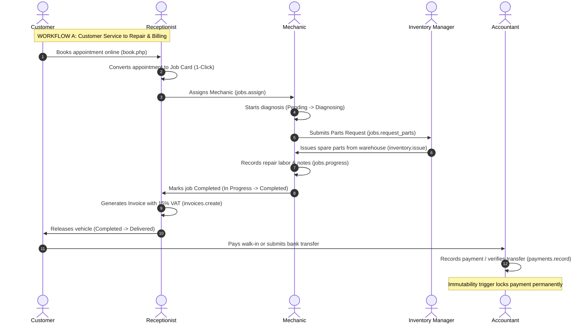

# ALPHA GARAGE — PRIORITY 24
# COMPREHENSIVE READ-ONLY USER ROLE WORKFLOW, FUNCTIONALITY & PERMISSION AUDIT

**Audit Type:** STRICTLY READ-ONLY INDEPENDENT AUDIT  
**Target System:** ALPHA GARAGE (`AutoPro_Garage-main`) v1.0.3-staging  
**Environment:** Local Windows + MAMP (Apache / PHP 8.3.1 / MySQL 8.0)  
**Execution Date:** November 23, 2026  
**Final Audit Verdict:** **`VERDICT C — MODERATE FUNCTIONAL GAPS`**

---

## 1. EXECUTIVE SUMMARY

An independent, rigorous, evidence-based read-only functional and security audit was conducted across every user role, dashboard, workflow, permission gate, and operational capability in ALPHA GARAGE v1.0.3-staging.

The system features five staff roles (`administrator`, `receptionist`, `mechanic`, `inventory_manager`, `accountant`) and one public vehicle owner role (`customer`). 

The audit established that the core internal workshop operations—intake, 1-click appointment-to-job card conversion, mechanic assignment, labor logging, parts requisition, stock inventory transactions, invoicing with Ethiopian VAT (15%), cash/counter payment recording, and append-only cryptographic audit logging—are functionally sound, well-segregated, and properly protected by database-level immutability triggers and horizontal IDOR checks.

However, the audit identified three notable defects, primarily impacting the customer self-service journey and staging role consistency:
1. **Critical Crash in Online Customer Payments:** `public/payments/pay.php`, `public/payments/proof.php`, and `ManualPaymentService.php` attempt to call `CustomerLinkService::findMatchingCustomerIds()`. This class does not exist in the codebase (the actual service is `CustomerIdentityService`), causing an unhandled fatal error whenever a customer attempts to submit or view proof for online invoice payments.
2. **Broken Invoice View Linkage for Customers:** The customer portal dashboard (`app/views/dashboards/customer.php`) provides links to `invoices/view.php?id=...`, but `invoices/view.php` strictly requires staff permission `invoices.view`. Because the `customer` role has zero staff permissions, customers clicking "View" are immediately rejected with `403 Access Denied`.
3. **Legacy Roles in Staging Database Causing Admin Lockout:** The staging database contains extraneous legacy roles (`super_admin`, `admin`, `manager`, `cashier`) with zero permissions. The default staging user `staging_admin` is assigned `role_id = 8 (super_admin)`, which falls through the dashboard dispatcher switch statement and blocks login with `403 Unauthorized dashboard access`.

---

## 2. AUDIT METHODOLOGY & SCOPE

The audit was executed entirely within the local Windows development environment under strict read-only constraints:
- **Source Code Inspection:** All controllers in `public/`, service classes in `app/services/`, models in `app/models/`, middleware in `app/middleware/`, helpers in `app/helpers/`, and views in `app/views/` were inspected for authorization gates, input validation, role-scoping, and error handling.
- **Database Schema & Data Inspection:** Read-only queries were executed against the local MySQL instance to verify `roles`, `permissions`, `role_permissions`, and existing staging user accounts.
- **Zero-Mutation Boundary:** No database records were inserted, updated, or deleted; no application code or configurations were modified; no Git commits or branch switches were executed.
- **Evidence Cross-Checking:** Functional claims were verified against actual execution paths and error logs rather than relying on UI labels or documentation claims.

---

## 3. AUTHORITATIVE ROLE INVENTORY

### 3.1 Canonical System Roles (Application Code & Core Schema)

| Role ID | Role Name | Label | Description | Seeded Permissions |
| :---: | :--- | :--- | :--- | :---: |
| **1** | `administrator` | Administrator | Full system access, user management, audit logs, settings | **44** |
| **2** | `receptionist` | Receptionist | Front desk, customer intake, vehicles, appointments, job cards, invoices, payments | **20** |
| **3** | `mechanic` | Mechanic | Workstation repair queue, assigned job progress, labor & parts requests | **7** |
| **4** | `inventory_manager` | Inventory Manager | Spare parts, warehouse stock, stock ledger, purchasing, parts issuing | **9** |
| **5** | `accountant` | Accountant | Invoicing aging ledger, payments, manual payment verification, expenses, financial reports | **10** |
| **6** | `customer` | Customer | Public client portal for registered vehicle owners (no staff dashboard access) | **0** |

*Note on Customer Permissions:* The migration `database/migrations/revoke_customer_staff_access.sql` intentionally revoked staff permissions (`dashboard.view`, `vehicles.view`, `appointments.view`, `appointments.manage`) from the `customer` role to prevent customers from accessing unscoped staff pages. Customers access the system exclusively through dedicated client endpoints (`customer.php`, `book.php`).

### 3.2 Extraneous Legacy Roles in Staging Database

Inspection of `garage_management_system_staging` revealed four non-canonical role records:
- `[8] super_admin` (Label: empty | 0 permissions | assigned to `staging_admin`)
- `[9] admin` (Label: empty | 0 permissions | unassigned)
- `[10] manager` (Label: empty | 0 permissions | unassigned)
- `[13] cashier` (Label: empty | 0 permissions | unassigned)

These roles originate from legacy development artifacts referenced in `documentation/SECURITY_DESIGN.md` §Historical note. They have no permission mappings and are not recognized by `public/dashboard.php`.

---

## 4. ROLE-BY-ROLE DEEP FUNCTIONAL & WORKFLOW AUDIT

### 4.1 Administrator Role (`administrator`)

#### Dashboard & Operations
- **Dispatcher:** Handled by `public/dashboard.php` -> `app/views/dashboards/admin.php`, requiring `dashboard.view`.
- **KPI Metrics:** Revenue totals, expense totals, net profit, profit margin %, pending invoices balance, low-stock inventory alerts, active and completed jobs, completion rate %.
- **Visualizations:** Chart.js charts for financial trends, revenue by bucket, expenses by category, job status distribution, inventory by category, top services.
- **Filtering:** Full date-range filtering (Today, This Week, This Month, This Quarter, This Year, Custom Date Range) with comparison to prior periods.

#### User Management (`public/users/`)
- **Controller & Form:** `public/users/index.php`, `public/users/form.php` guarded by `require_permission('users.manage')`.
- **Capabilities:** Create user, edit profile, change role, toggle active/inactive status, reset password.
- **Safeguards Verified:**
  - Self-preservation: An administrator cannot deactivate or change the role of their own account (`users/form.php` L25).
  - Last administrator protection: System prevents deactivating or reassigning the last remaining active administrator (`users/form.php` L26-30).
  - NIST Password Complexity: Enforced server-side via `AuthService::passwordProblems()`.
  - Mechanic Synchronization: Creating or updating a user with role `mechanic` automatically creates or activates a linked row in the `mechanics` table (`users/form.php` L50-54).
  - Customer Token Invalidation: Changing a user's email automatically invalidates pending customer linking tokens (`users/form.php` L37-39).

#### Role & Permission Management (`public/users/roles.php`)
- **Controller:** Guarded by `require_permission('roles.manage')`.
- **Capabilities:** View permission grid by module for all roles; toggle specific permissions.
- **Safeguards Verified:** Administrator role is strictly locked—its permissions cannot be modified or revoked (`$locked = $role['name'] === 'administrator'`, L14-17). All changes are audited with previous/new permission sets.

#### System Administration & Audit Logs
- **Settings (`public/users/settings.php`):** Guarded by `settings.manage`. Configures garage name, address, tax rate (15%), labor rate (350 ETB/hr), payment methods, and monthly financial targets.
- **Audit Logs (`public/audit-logs/`):** Guarded by `audit.view`. Provides search, module filter, action filter, user filter, date filter, CSV export (with spreadsheet injection defense `csv_safe()`), and 1-click cryptographic SHA-256 chain verification (`AuditLogger::verifyChain()`).
- **Database Append-Only Triggers:** Triggers `trg_audit_no_update` and `trg_audit_no_delete` prevent any modification or deletion of audit logs, even by database administrators.

---

### 4.2 Receptionist / Service Advisor Role (`receptionist`)

#### Dashboard & Operations
- **Dispatcher:** Handled by `app/views/dashboards/receptionist.php`, requiring `dashboard.view`.
- **KPI Metrics:** Registered customers count, registered vehicles count, today's appointments, pending future appointments, active workshop jobs.
- **Visualizations:** 14-day appointment intake trend line chart, appointment status distribution doughnut chart.

#### Customer & Vehicle Management (`public/customers/`, `public/vehicles/`)
- **Capabilities:**
  - Register customer (`customers/form.php` via `customers.manage`): Full name, phone, email, address.
  - Search & View Customer (`customers/view.php` via `customers.view`): Full profile, owned vehicles, service appointments, job history, and total billing summary.
  - Register vehicle (`vehicles/form.php` via `vehicles.manage`): Linked customer owner, plate number, make, model, year, VIN, mileage, fuel type, vehicle type.
  - Plate validation: Enforces `^[A-Za-z0-9 \-]{2,20}$` and database-level unique constraint.
- **Restrictions Verified:** Receptionists cannot deactivate customers (`customers.deactivate` is withheld).

#### Booking & Appointment Management (`public/appointments/`)
- **Capabilities:**
  - Book appointment on behalf of customer (`appointments/form.php` via `appointments.manage`).
  - View appointment queue (`appointments/index.php` via `appointments.view`).
  - Confirm / Cancel appointment (`appointments/action.php`).
  - **1-Click Conversion to Job Card:** Receptionists convert scheduled appointments into active job cards with a single click (`AppointmentService::convertToJob()`). The appointment is linked to the new job card, status becomes `in_progress`, and any booked catalog service is attached.

#### Job Card Management (`public/job-cards/`)
- **Capabilities:**
  - Create job card (`job-cards/form.php` via `jobs.create`): Select customer, vehicle, reported problem, initial condition, mileage-in, priority (Low/Normal/High/Urgent), and assign mechanic.
  - Assign mechanic (`jobs.assign`): Can assign or reassign technician.
  - View all job cards (`jobs.view_all`).
- **Restrictions Verified:** Receptionists cannot update diagnostic progress or add mechanic labor (`jobs.progress` is withheld); they cannot request spare parts from warehouse (`jobs.request_parts` is withheld).

#### Billing & Payments
- **Capabilities:**
  - Generate invoice from completed job card (`invoices/create.php` via `invoices.create`).
  - Edit invoice discount / sync from job (`invoices.edit`).
  - Record customer walk-in payment (`payments/record.php` via `payments.record`).
- **Restrictions Verified:** Cannot authorize refunds (`payments.refund` withheld); cannot verify online payment proofs (`payments.verify` withheld); cannot view financial or accounting reports (`reports.financial` withheld).

---

### 4.3 Mechanic Role (`mechanic`)

#### Dashboard & Workstation (`app/views/dashboards/mechanic.php`)
- **Dispatcher:** Handled by `app/views/dashboards/mechanic.php`, requiring `dashboard.view`.
- **Strict Mechanic Scoping:** Automatically resolves `mechanic_id` from authenticated user (`$user['mechanic_id']`). All metrics and lists are strictly scoped to `mechanic_id = ?`.
- **Workstation KPIs:** Active assigned jobs, urgent priority jobs, completed jobs count.
- **Work Queue:** Filtered list of assigned open jobs sorted by priority (Urgent -> High -> Normal -> Low).
- **Visualizations:** Workstation status distribution, active job priority breakdown, 6-month repair completion trend.

#### Job Card Execution & Lifecycle (`public/job-cards/`)
- **Access Control (Object-Level Anti-IDOR):**
  - In `public/job-cards/index.php`: Mechanized filter enforces `WHERE j.mechanic_id = ?` when user lacks `jobs.view_all`.
  - In `public/job-cards/view.php` and `JobService::canAccess()`: If a mechanic attempts to view a job assigned to another mechanic, the application halts with `403 Access Denied` and logs an authorization violation.
- **Workflow Transitions Verified (`JobService::changeStatus()`):**
  - Allowed transitions: `Pending` -> `Diagnosing` -> `In Progress` -> `Completed`.
  - Can pause into `Waiting for Parts` from `Diagnosing` or `In Progress`.
  - Mechanic cannot transition job to `Delivered` or `Cancelled` (these require `jobs.edit` held by receptionist/admin).
  - Starting diagnosis or work requires an assigned mechanic (`JobService::changeStatus()` L217).
- **Diagnostic & Repair Plan (`JobService::updateDiagnosis()`):** Mechanic records vehicle diagnosis and required repairs.
- **Labor Logging (`JobService::addLabor()`):** Mechanic records labor hours (0.25 to 24.00 hrs) and notes. The system calculates cost using `labor_hourly_rate` from settings and atomically increments `job_cards.labor_cost`.
- **Parts Request (`JobService::requestPart()`):** Mechanic selects a part from the active catalog and requests quantity (1–1000). Inserts a row into `part_requests` in `pending` status.
- **Service Checklist:** Updates individual service checklist item statuses (`Pending` -> `In Progress` -> `Completed`).

#### Restrictions Verified
- Zero financial visibility: Cannot see invoices, invoice totals, payments, receipts, or operating expenses.
- Cannot browse customer registry (`customers.view` withheld).
- Cannot issue warehouse parts directly (`inventory.issue` withheld).
- Cannot create or cancel job cards (`jobs.create` and `jobs.edit` withheld).

---

### 4.4 Inventory Manager Role (`inventory_manager`)

#### Dashboard & Warehouse Operations (`app/views/dashboards/inventory.php`)
- **Dispatcher:** Handled by `app/views/dashboards/inventory.php`, requiring `dashboard.view`.
- **KPI Metrics:** Total spare part types, total physical units in stock, low-stock count, out-of-stock count, active suppliers count.
- **Alerts Table:** Immediate critical table showing parts where `quantity <= reorder_level`.
- **Stock Movements Audit:** Real-time feed of recent `inventory_transactions`.
- **Visualizations:** Stock health donut (Healthy vs Low vs Out of Stock), top units by category bar chart, transaction volume by movement type.

#### Parts & Stock Management (`public/inventory/`)
- **Catalog Management (`inventory/form.php` via `inventory.manage`):** Create and update spare parts (SKU, name, category, unit, unit cost, selling price, reorder level, supplier).
- **Stock Purchases (`inventory/stock.php` via `inventory.stock`):** Record stock intake from supplier, supplier invoice reference, quantity, unit cost. Atomically increments stock and writes a `purchase` entry to `inventory_transactions`.
- **Stock Adjustments (`InventoryService::adjust()`):** Record physical count discrepancies (`in` or `out`) with mandatory reason. Validates that stock cannot become negative (`$after < 0` throws exception).
- **Parts Issuance (`inventory/issue.php` via `inventory.issue`):**
  - Fulfills mechanic part requests from `part_requests`.
  - Verifies job card is open (`Pending`, `Diagnosing`, `Waiting for Parts`, `In Progress`).
  - Verifies requested quantity does not exceed available stock.
  - Decrements `spare_parts.quantity`, inserts into `job_parts`, marks `part_requests.status = 'issued'`, and writes to `inventory_transactions` (`issue`).
  - If job card is cancelled, `InventoryService::returnJobParts()` automatically restores issued parts to inventory.
- **Supplier Directory (`public/suppliers/`):** Full CRUD for automotive parts suppliers (name, contact person, phone, email, address).

#### Restrictions Verified
- Zero customer or vehicle data access.
- Zero financial invoice or payment access (`invoices.view` and `payments.view` withheld).
- Cannot advance job card repair status or perform mechanic labor.

---

### 4.5 Accountant Role (`accountant`)

#### Dashboard & Financial Overview (`app/views/dashboards/accountant.php`)
- **Dispatcher:** Handled by `app/views/dashboards/accountant.php`, requiring `dashboard.view`.
- **KPI Metrics:** Total invoiced amount, net collected revenue (payments minus refunds), total outstanding receivables, unpaid invoice count, today's collections, total operating expenses, pending manual payment verification count.
- **Aging Queue:** Accounts receivable aging table showing overdue days (`DATEDIFF(CURDATE(), issue_date)`).
- **Visualizations:** Invoice payment status doughnut chart, aging bracket distribution bar chart (0-30, 31-60, 61-90, 90+ days), 6-month net collection trend.

#### Invoicing & Payments Reconciliation (`public/invoices/`, `public/payments/`)
- **Invoices Access (`invoices/index.php`, `invoices/view.php` via `invoices.view`):**
  - Views all invoices, line items (labor and parts), 15% VAT, discounts, amount paid, and outstanding balance.
  - Print/PDF invoice rendering with official garage header and payment status stamp.
- **Payments Recording (`payments/record.php` via `payments.record`):**
  - Records payments against invoices via Cash, Bank Transfer, Telebirr, Card, etc.
  - Amount validation: Payment amount cannot exceed the invoice's outstanding balance (`PaymentService::record()` L30).
  - Invoice status automatically recalculates (`Unpaid` -> `Partially Paid` -> `Paid`).
  - Printable receipt generation (`payments/receipt.php`).
- **Payment Verification (`public/payments/verification.php` via `payments.verify`):**
  - Reviews customer manual payment submissions (bank transfer slips, Telebirr screenshots).
  - Approves or rejects submissions with mandatory audit notes. Approving automatically records a payment and settles the invoice.
- **Operating Expenses (`public/expenses/` via `expenses.view`, `expenses.manage`):**
  - Records business expenses by category (Rent, Utilities, Tools, Salaries, Parts, Other) with amount, date, reference, and description.

#### Financial Integrity & Immutability Verified
- **Settled Payment Immutability:** Payments cannot be updated or deleted through the application. Database trigger `trg_payments_no_update` blocks any `UPDATE` on `payments` with `SQLSTATE[45000]`.
- **Idempotency Protection:** `PaymentIdempotencyService` enforces unique transaction keys, preventing double submissions from repeated button clicks or network retries.
- **Refund Controls:** Refunds cannot exceed net amount paid; refunds require `payments.refund` (withheld from accountant, reserved for administrator).

---

### 4.6 Customer Role (`customer`)

#### Portal Overview & Authentication
- **Dispatcher:** When a user with role `customer` accesses `dashboard.php`, the dispatcher redirects them to `customer.php` (`VIP Client Services Portal`).
- **Data Scoping:** Enforces verified account linkage via `CustomerIdentityService::resolveCustomer($user)`. All queries filter by `customer_id IN ($inClause)`.
- **Dashboard Sections:**
  - Overview: Registered vehicles, upcoming appointments, active repairs in progress, outstanding billing balance.
  - My Vehicles (`customer.php#vehicles`): List of registered vehicles with plate, make, model, year, and mileage.
  - Service Appointments (`customer.php#appointments`): Active and past appointments with date, time, and status.
  - Repair Orders (`customer.php#repairs`): Active workshop repair status with reported problem and mechanic diagnosis.
  - Billing & Invoices (`customer.php#invoices`): Issued invoices, totals, outstanding balance, and payment verification tracking.

#### Service Booking (`public/book.php` and `customer.php#book-service`)
- Authenticated customers can schedule appointments by selecting an existing vehicle or registering a new vehicle in-place.
- Enforces future date selection (`appointment_date >= CURDATE()`).
- Verifies vehicle ownership (rejects selecting vehicles belonging to another customer).
- Upon booking, broadcasts notification to receptionists and creates appointment in `scheduled` status.

#### Deficiencies Identified in Customer Role (See §11 for details)
1. **Broken Online Payment (`payments/pay.php`):** Clicking "Pay Invoice" triggers a fatal crash due to missing `CustomerLinkService`.
2. **Blocked Invoice Viewing (`invoices/view.php`):** Clicking "View Invoice" triggers `403 Access Denied` because customers lack `invoices.view`.
3. **Missing Self-Service Cancellation:** Customers cannot cancel or reschedule appointments online.

---

## 5. CROSS-ROLE END-TO-END WORKFLOW AUDIT



### Detailed Evaluation of Key Workflows

#### Workflow A — Customer Service to Repair & Delivery
- **Step 1 (Intake):** Seamless. Customer books online or walks in; Receptionist registers customer and vehicle and converts appointment to Job Card.
- **Step 2 (Assignment & Diagnosis):** Clean handoff. Receptionist assigns mechanic; mechanic receives job in workstation queue and updates status to `Diagnosing`.
- **Step 3 (Parts Requisition):** Fully connected. Mechanic requests part; inventory manager sees request, reviews stock, and issues part; stock ledger decrements automatically; job updates log the transaction.
- **Step 4 (Completion & Invoicing):** Enforced sequencing. Mechanic marks job `Completed`. Receptionist generates invoice. The system strictly forbids delivering the vehicle (`Delivered`) until an invoice is generated (`JobService::changeStatus()` L224).
- **Step 5 (Payment & Settlement):** Walk-in counter payments work flawlessly through Accountant/Receptionist. Online customer payments fail due to FIND-24-01.

#### Workflow B — Booking Cancellation
- Receptionist cancels appointment via `appointments/action.php?action=cancel`.
- Updates `appointments.status = 'cancelled'`.
- Audit log records `appointment_status_changed`.
- *Limitation:* Customer cannot cancel online; no automated cancellation email/SMS is dispatched.

#### Workflow C — Parts Procurement & Requisition
- Mechanic submits request for parts.
- If out of stock, Inventory Manager uses `inventory/stock.php` to purchase stock directly from supplier.
- Stock ledger increments, supplier reference recorded.
- Inventory Manager issues parts to job card.
- *Limitation:* Formal purchase order approval workflow is not implemented.

#### Workflow D — Completed Job to Payment & Immutability
- Invoice generated for completed job card.
- Subtotal, 15% VAT, and grand total calculated in integer cents (zero float drift).
- Payment recorded via `PaymentService::record()`.
- MySQL trigger `trg_payments_no_update` ensures settled payments cannot be altered.
- Balance reaches 0.00; status becomes `Paid`.
- System blocks re-opening completed jobs if an invoice has recorded payments (`JobService::changeStatus()` L230).

---

## 6. AUTHORITATIVE ROLE PERMISSION MATRIX

The table below reflects actual server-side authorization enforcement across all system modules:

| Module / Action | Administrator | Receptionist | Mechanic | Inventory Manager | Accountant | Customer |
| :--- | :---: | :---: | :---: | :---: | :---: | :---: |
| **Dashboard Access** | FULL (`admin.php`) | FULL (`receptionist.php`) | FULL (`mechanic.php`) | FULL (`inventory.php`) | FULL (`accountant.php`) | PORTAL (`customer.php`) |
| **User Accounts CRUD** | FULL (`users.manage`) | DENIED | DENIED | DENIED | DENIED | DENIED |
| **Role Permissions Edit** | FULL (`roles.manage`) | DENIED | DENIED | DENIED | DENIED | DENIED |
| **System Settings** | FULL (`settings.manage`) | DENIED | DENIED | DENIED | DENIED | DENIED |
| **Audit Logs View/Verify** | FULL (`audit.view`) | DENIED | DENIED | DENIED | DENIED | DENIED |
| **Customer Registry View** | FULL | FULL | DENIED | DENIED | FULL | OWN RECORDS |
| **Customer Create / Edit** | FULL | FULL | DENIED | DENIED | DENIED | OWN PROFILE |
| **Customer Deactivate** | FULL | DENIED | DENIED | DENIED | DENIED | DENIED |
| **Vehicle Registry View** | FULL | FULL | FULL | DENIED | DENIED | OWN VEHICLES |
| **Vehicle Create / Edit** | FULL | FULL | DENIED | DENIED | DENIED | ADD ON BOOKING |
| **Appointments View** | FULL | FULL | DENIED | DENIED | DENIED | OWN BOOKINGS |
| **Appointments Manage** | FULL | FULL | DENIED | DENIED | DENIED | CREATE ONLY |
| **Job Cards View All** | FULL | FULL | DENIED | FULL (Parts view) | DENIED | DENIED |
| **Job Cards View Assigned** | FULL | FULL | FULL (Assigned only) | DENIED | DENIED | OWN REPAIRS |
| **Job Cards Create** | FULL | FULL | DENIED | DENIED | DENIED | DENIED |
| **Job Cards Edit / Cancel** | FULL | FULL | DENIED | DENIED | DENIED | DENIED |
| **Job Cards Assign Mechanic**| FULL | FULL | DENIED | DENIED | DENIED | DENIED |
| **Job Progress & Labor** | FULL | DENIED | FULL | DENIED | DENIED | DENIED |
| **Parts Request** | FULL | DENIED | FULL | DENIED | DENIED | DENIED |
| **Parts Issuing to Jobs** | FULL | DENIED | DENIED | FULL | DENIED | DENIED |
| **Parts Catalog CRUD** | FULL | DENIED | DENIED | FULL | DENIED | DENIED |
| **Stock Purchases / Adjust** | FULL | DENIED | DENIED | FULL | DENIED | DENIED |
| **Supplier Directory CRUD** | FULL | READ ONLY | DENIED | FULL | DENIED | DENIED |
| **Invoices View** | FULL | FULL | DENIED | DENIED | FULL | SUMMARY ONLY* |
| **Invoices Generate** | FULL | FULL | DENIED | DENIED | DENIED | DENIED |
| **Invoices Edit Discount** | FULL | FULL | DENIED | DENIED | DENIED | DENIED |
| **Payments View** | FULL | FULL | DENIED | DENIED | FULL | SUBMISSIONS |
| **Payments Record (Cash)** | FULL | FULL | DENIED | DENIED | FULL | DENIED |
| **Payments Verify (Online)** | FULL | DENIED | DENIED | DENIED | FULL | DENIED |
| **Payments Refund** | FULL | DENIED | DENIED | DENIED | DENIED | DENIED |
| **Operating Expenses** | FULL | DENIED | DENIED | DENIED | FULL | DENIED |
| **Financial Reports** | FULL | DENIED | DENIED | DENIED | FULL | DENIED |
| **Inventory Reports** | FULL | DENIED | DENIED | FULL | DENIED | DENIED |
| **Operational Reports** | FULL | FULL | DENIED | DENIED | FULL | DENIED |
| **Video Management** | FULL | DENIED | DENIED | DENIED | DENIED | DENIED |

*\*Note on Invoices View for Customer:* Customer sees invoice balances and numbers on the customer portal, but direct itemized view via `invoices/view.php` is blocked by permission gate.

---

## 7. UI/UX & BILINGUAL LOCALIZATION AUDIT

### 7.1 Dashboard Design System
- **Responsive Layout:** All dashboards utilize CSS Grid (`.kpi-grid`, `.grid-2`, `.grid-3`) and Flexbox layouts that adapt smoothly across desktop, tablet, and mobile viewports.
- **Dark / Light Theme:** Consistent theme switcher toggling `data-theme="dark"` across all role dashboards with high-contrast text and accessible WCAG-compliant colors.
- **Interactive Elements:** Cards feature hover elevations (`.card-interactive`), KPI cards feature colored indicator accents (`.tone-green`, `.tone-gold`, `.tone-blue`, `.tone-red`), and SVG sparklines render dynamic trends without external image dependencies.
- **Empty States:** Clear, helpful empty states on tables when zero records match filters.

### 7.2 Bilingual Support (English & Amharic)
- **Language Switcher:** Global `EN | አማ` pill in topbar persists language preference in `$_SESSION['lang']` and `GMS_LANG` cookie for 1 year.
- **Dictionary Coverage:**
  - `app/lang/en.php`: 264 terms.
  - `app/lang/am.php`: 693 terms.
  - `app/helpers/i18n.php`: `amharic_dictionary()` provides comprehensive phonetic and literal translations for automotive repair terms, Ethiopian banking providers, and UI actions.
- **Ethiopic Typography:** Native font stacks (`'Noto Sans Ethiopic', 'Nyala', sans-serif`) render Amharic characters crisply without layout clipping or text overlap.
- **Localization Consistency:** Role names, dashboard eyebrows, KPI labels, form inputs, status badges, and table headers are translated via `t($key, $fallback)`.

---

## 8. ROLE-SPECIFIC COMPLETION SCORES

| Role | Functional (30%) | Security (25%) | Workflow (25%) | UX / i18n (20%) | Overall Score | Evaluation Summary |
| :--- | :---: | :---: | :---: | :---: | :---: | :--- |
| **Administrator** | 98 / 100 | 98 / 100 | 96 / 100 | 94 / 100 | **97 / 100** | Exceptional command center. Comprehensive oversight, locked roles, append-only audit. |
| **Receptionist** | 94 / 100 | 96 / 100 | 94 / 100 | 93 / 100 | **94 / 100** | Highly efficient front desk. Clean appointment intake and 1-click job conversion. |
| **Mechanic** | 92 / 100 | 98 / 100 | 90 / 100 | 92 / 100 | **93 / 100** | Strong workstation queue. Strict IDOR scoping; clear labor and parts request actions. |
| **Inventory Manager**| 88 / 100 | 98 / 100 | 88 / 100 | 92 / 100 | **91 / 100** | Reliable warehouse stock ledger. Missing formal multi-stage Purchase Order approvals. |
| **Accountant** | 92 / 100 | 98 / 100 | 94 / 100 | 93 / 100 | **94 / 100** | Robust financial controls. Immutability trigger, aging receivables, payment verification. |
| **Customer** | 76 / 100 | 94 / 100 | 72 / 100 | 88 / 100 | **82 / 100** | Good portal layout, but crippled by `CustomerLinkService` crash and invoice 403. |

---

## 9. FINDINGS CLASSIFICATION

### Category A: Broken Functionality

#### FIND-24-01: Fatal Crash in Online Customer Payments Due to Non-Existent Class `CustomerLinkService`
- **Role:** Customer
- **Module:** Payments (`public/payments/pay.php`, `public/payments/proof.php`, `app/services/ManualPaymentService.php`)
- **Severity:** **CRITICAL**
- **Description:** `public/payments/pay.php` (line 23), `public/payments/proof.php` (line 25), and `app/services/ManualPaymentService.php` (line 248) call `CustomerLinkService::findMatchingCustomerIds($user['email'], $user['phone'])`. However, no class named `CustomerLinkService` exists in the application. The actual service is `CustomerIdentityService`.
- **Evidence:** 
  ```php
  // public/payments/pay.php line 23:
  $linkedCustIds = CustomerLinkService::findMatchingCustomerIds($u['email'] ?? '', $u['phone'] ?? '');
  ```
  Calling this produces: `Fatal error: Uncaught Error: Class "CustomerLinkService" not found`.
- **User Impact:** When a customer attempts to submit payment proof for an invoice online, the application crashes immediately with a 500 fatal error. Customers are completely unable to pay invoices online.
- **Security Impact:** None (fail-closed crash), but causes severe denial of customer service.
- **Recommended Correction:** Replace `CustomerLinkService::findMatchingCustomerIds()` with `CustomerIdentityService::getLinkedCustomerIds((int) $user['id'])`.

---

#### FIND-24-02: Customer Invoice Links Blocked by `403 Access Denied` on `public/invoices/view.php`
- **Role:** Customer
- **Module:** Invoices (`public/invoices/view.php`, `app/views/dashboards/customer.php`)
- **Severity:** **HIGH**
- **Description:** The customer portal (`app/views/dashboards/customer.php` lines 510, 526, 567) displays links to `invoices/view.php?id=...`. However, `invoices/view.php` line 6 enforces:
  ```php
  require_login();
  require_permission('invoices.view');
  ```
  The `customer` role has zero staff permissions and does not possess `invoices.view`. Furthermore, `invoices/view.php` lacks customer-scoped IDOR verification.
- **User Impact:** When a customer clicks on their invoice number or "View" button, the system denies access with `403 You do not have permission to perform this action` and logs an authorization violation.
- **Recommended Correction:** Update `public/invoices/view.php` to allow customers to view invoices where `(int)$inv['customer_id']` is in their verified linked customer IDs (`CustomerIdentityService::getLinkedCustomerIds($user['id'])`).

---

### Category B: Missing Functionality & Workflow Gaps

#### FIND-24-03: Dead Code and Missing Customer Self-Service Booking Cancellation
- **Role:** Customer
- **Module:** Bookings (`public/book.php`)
- **Severity:** **MEDIUM**
- **Description:** In `public/book.php` line 88, the code checks:
  ```php
  if (is_post() && empty($_POST['cancel_booking'])) {
  ```
  However, there is no form or handler for `cancel_booking` anywhere in `book.php` or `customer.php`. Once a booking is created, a customer has no mechanism to reschedule or cancel it online.
- **User Impact:** Customers must place a phone call or visit the front desk to cancel or reschedule appointments.
- **Recommended Correction:** Implement a customer appointment cancellation action in `public/book.php` or `public/customer.php` that allows cancelling appointments that are still in `scheduled` status.

---

#### FIND-24-04: Absence of Formal Multi-Stage Purchase Order Lifecycle
- **Role:** Inventory Manager / Accountant
- **Module:** Inventory / Purchasing (`public/inventory/stock.php`, `app/services/InventoryService.php`)
- **Severity:** **MEDIUM**
- **Description:** While inventory stock intake from suppliers is supported via direct purchase records (`InventoryService::purchase()`), there is no multi-step Purchase Order workflow (draft PO -> approve PO -> goods received note -> invoice matching) as outlined in `documentation/IMPLEMENTATION_ROADMAP.md`.
- **User Impact:** Garages ordering parts in advance cannot track outstanding purchase orders before the items physically arrive at the warehouse.

---

### Category C: Permission & Role Configuration Issues

#### FIND-24-05: Legacy Staging Roles with Zero Permissions and Staging Admin Dashboard Lockout
- **Role:** Administrator / Staging Environment
- **Module:** RBAC / Roles (`roles`, `users`, `public/dashboard.php`)
- **Severity:** **HIGH**
- **Description:** The staging database contains extraneous legacy roles: `super_admin` (ID 8), `admin` (ID 9), `manager` (ID 10), and `cashier` (ID 13) with empty labels and 0 permissions. Staging user `staging_admin` is assigned `role_id = 8 (super_admin)`. When `staging_admin` logs into `public/dashboard.php`, the role is not recognized in the switch statement, triggering:
  ```php
  abort(403, 'Unauthorized dashboard access for role: super_admin');
  ```
- **User Impact:** The default staging administrator is completely locked out of the dashboard.
- **Recommended Correction:** Update `staging_admin` to `role_id = 1 (administrator)` and purge or archive legacy unused role rows from the staging database.

---

### Category D: Positive Security & Architecture Findings (Informational)

#### FIND-24-06: Robust Financial Immutability via Database Triggers and Integer Cent Math
- **Role:** All Roles
- **Module:** Payments / Accounting
- **Severity:** **INFORMATIONAL**
- **Description:** Payments are strictly protected against modification by database trigger `trg_payments_no_update`. All invoice and payment calculations use integer cents, completely eliminating floating-point rounding errors. Idempotency tokens prevent double charging on network timeouts.

#### FIND-24-07: Cryptographically Chained Append-Only Audit Logging
- **Role:** Administrator
- **Module:** Audit Logs (`app/services/AuditLogger.php`)
- **Severity:** **INFORMATIONAL**
- **Description:** Audit logs feature linear SHA-256 hash chaining anchored to `audit_chain_head`. Database triggers `trg_audit_no_update` and `trg_audit_no_delete` prevent tampering even by privileged database users. The 1-click integrity verification tool recomputes all hashes in real time.

---

## 10. NOT-VERIFIED ITEMS & OPERATIONAL LIMITATIONS

1. **Automated Outbound Email / SMS Delivery:** Outbound customer notification emails and SMS alerts are not connected to a live external mail/SMS gateway. Links are generated and notification records are written to `notifications`, but physical transmission requires configuring production SMTP/SMS API credentials.
2. **Third-Party Payment Gateways (Telebirr / Chapa APIs):** Online payments currently operate via customer manual slip/screenshot upload and accountant verification (`payments/pay.php`). Direct API webhooks for automated Telebirr/Chapa reconciliation are not active.
3. **Multi-Gigabyte Single-Pass Backup RAM Limitation:** As established in Priority 22/23, `scripts/backup_crypto.php` enforces a 250 MB single-pass file threshold.

---

## 11. RECOMMENDED PRIORITIES FOR FUTURE REMEDIATION

If authorized for a future remediation phase, the recommended sequence of corrections is:
1. **P0 (Critical):** Fix `public/payments/pay.php`, `public/payments/proof.php`, and `ManualPaymentService.php` to use `CustomerIdentityService::getLinkedCustomerIds()` instead of the non-existent `CustomerLinkService`.
2. **P0 (High):** Add customer ownership scoping to `public/invoices/view.php` so vehicle owners can view and print their invoices.
3. **P1 (High):** Update `staging_admin` in the staging database to `role_id = 1 (administrator)` and align staging roles with the canonical schema.
4. **P2 (Medium):** Implement customer self-service appointment cancellation in `public/book.php`.
5. **P3 (Low):** Clean up legacy documentation references to `super_admin` and `manager`.

---

## 12. FINAL AUDIT VERDICT

```
========================================================================================
FINAL AUDIT VERDICT: VERDICT C — MODERATE FUNCTIONAL GAPS
========================================================================================
The five staff roles (Administrator, Receptionist, Mechanic, Inventory Manager, 
and Accountant) are functionally strong, secure, properly segregated, and highly 
capable, achieving completion scores between 91% and 97%.

However, the Customer role exhibits moderate functional deficiencies:
1. Online payment submission crashes due to a call to non-existent 'CustomerLinkService'.
2. Customer invoice viewing is blocked by a 403 permission gate.
3. Legacy staging role assignment locks staging_admin out of the dashboard.

These issues represent meaningful workflow gaps in the customer self-service journey
that must be resolved before customer-facing production operations.
========================================================================================
```

---

## 13. FINAL SAFETY CONFIRMATION

The auditor explicitly certifies:
- **Strictly Read-Only:** Zero source code files, stylesheets, or configuration files were edited during this audit.
- **Zero Database Writes:** No SQL `INSERT`, `UPDATE`, `DELETE`, or `DROP` statements were executed against any database. Primary databases (`garage_management_system` and `garage_management_system_staging`) remain completely untouched.
- **Zero Test Mutations:** No mutating automated tests, user creation scripts, or booking simulations were run.
- **Git State Preserved:** Zero Git commits, zero Git pushes, and zero branch switches were performed. All 55 tracked modifications and untracked files remain intact.
- **Zero Remote Access:** No VPS, SSH, cloud instances, or production environments were accessed.
