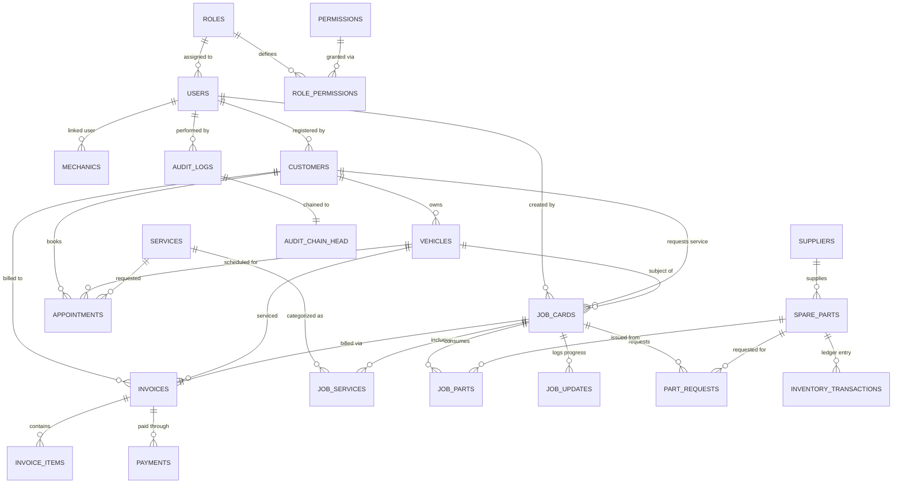

# Database Design & Entity Relationship Architecture

**Database Name:** `garage_management_system`  
**Storage Engine:** InnoDB  
**Character Set / Collation:** `utf8mb4` / `utf8mb4_unicode_ci`  
**Normalization Level:** Third Normal Form (3NF)

---

## 1. Normalization & Integrity Principles

1. **First Normal Form (1NF):**
   - Every column contains atomic values.
   - Repeating groups and multi-valued comma-separated lists are strictly prohibited (e.g. services attached to job cards are stored in `job_services`, parts in `job_parts`, invoice items in `invoice_items`).
   - Every table possesses an explicit primary key (`id`).

2. **Second Normal Form (2NF):**
   - Tables with composite primary keys (e.g. `role_permissions` with `(role_id, permission_id)`) contain only attributes that depend fully on the complete composite key.
   - All non-key attributes are fully functionally dependent on the table's primary key.

3. **Third Normal Form (3NF):**
   - No transitive dependencies exist.
   - Non-key columns depend only on the primary key (e.g. vehicle owner details reside in `customers` and are referenced by `customer_id` rather than duplicated in `vehicles` or `job_cards`).
   - Line totals and invoice balances are calculated deterministically on the server side from line items and payments to avoid anomalies.

---

## 2. Entity Relationship Diagram (Mermaid)



---

## 3. Database Entities Summary

| Table | Purpose | Primary Key | Foreign Keys / Key Constraints |
|---|---|---|---|
| `roles` | System roles (Administrator, Receptionist, Mechanic, Inventory Manager, Accountant) | `id` (TINYINT) | `name` UNIQUE |
| `permissions` | Granular system capabilities | `id` (SMALLINT) | `code` UNIQUE |
| `role_permissions` | RBAC mapping junction | `(role_id, permission_id)` | FK `roles(id)`, FK `permissions(id)` |
| `users` | Staff credentials and active status | `id` (INT) | FK `roles(id)`, `username` UNIQUE, `email` UNIQUE |
| `mechanics` | Workshop technicians, specialty, workload | `id` (INT) | FK `users(id)` (Nullable) |
| `customers` | Vehicle owners, contact data, active flag | `id` (INT) | FK `users(id)` (`created_by`) |
| `vehicles` | Fleet registry, plate, VIN, odometer, fuel | `id` (INT) | FK `customers(id)`, `plate_number` UNIQUE, `vin` UNIQUE |
| `services` | Standard service catalog and pricing | `id` (INT) | `code` UNIQUE |
| `suppliers` | External parts vendors and contact details | `id` (INT) | `code` UNIQUE |
| `appointments` | Service bookings and workshop scheduling | `id` (INT) | FK `customers(id)`, FK `vehicles(id)`, FK `services(id)`, FK `job_cards(id)` |
| `job_cards` | Work order entity and status state machine | `id` (INT) | FK `customers(id)`, FK `vehicles(id)`, FK `mechanics(id)`, FK `users(id)` |
| `job_services` | Specific services attached to a job card | `id` (INT) | FK `job_cards(id)`, FK `services(id)`, FK `mechanics(id)` |
| `job_updates` | Timeline log of job notes, status, labor | `id` (INT) | FK `job_cards(id)`, FK `users(id)` |
| `spare_parts` | Stock inventory items, unit price/cost, reorder | `id` (INT) | FK `suppliers(id)`, `sku` UNIQUE |
| `inventory_transactions` | Double-entry stock ledger with balance tracking | `id` (BIGINT) | FK `spare_parts(id)`, FK `job_cards(id)`, FK `users(id)` |
| `job_parts` | Parts issued to specific job cards | `id` (INT) | FK `job_cards(id)`, FK `spare_parts(id)`, FK `users(id)` |
| `part_requests` | Technician requests to warehouse | `id` (INT) | FK `job_cards(id)`, FK `spare_parts(id)`, FK `users(id)` |
| `invoices` | Financial invoice generated from completed jobs | `id` (INT) | FK `job_cards(id)` (1-to-1), FK `customers(id)`, FK `vehicles(id)` |
| `invoice_items` | Breakdown of labor, catalog services, parts | `id` (INT) | FK `invoices(id)`, FK `spare_parts(id)` |
| `payments` | Immutable payment ledger and refund records | `id` (INT) | FK `invoices(id)`, FK `users(id)`, `receipt_number` UNIQUE |
| `notifications` | In-app notification center and broadcast alerts | `id` (BIGINT) | Indexed on `(user_id, is_read)`, `(role_name, is_read)` |
| `audit_logs` | Cryptographic SHA-256 hash-chained log | `id` (BIGINT) | Appended with `prev_hash` & `row_hash` |
| `audit_chain_head` | Lock table for linearizing hash appends | `id` (TINYINT) | Row `id = 1` locked via `SELECT ... FOR UPDATE` |
| `login_attempts` | Rate limiting for brute-force defense | `id` (BIGINT) | Indexed on `(username, attempted_at)`, `(ip_address, attempted_at)` |
| `garage_settings` | Key-value store for workshop preferences | `setting_key` | PK `setting_key` |

---

## 4. Key Performance Indexes

```sql
-- Fast search and sorting indexes
CREATE INDEX idx_cust_name ON customers (full_name);
CREATE INDEX idx_cust_phone ON customers (phone);
CREATE INDEX idx_veh_customer ON vehicles (customer_id);
CREATE INDEX idx_job_status ON job_cards (status);
CREATE INDEX idx_job_mech ON job_cards (mechanic_id);
CREATE INDEX idx_job_received ON job_cards (date_received);
CREATE INDEX idx_inv_status ON invoices (payment_status);
CREATE INDEX idx_inv_date ON invoices (issue_date);
CREATE INDEX idx_it_part ON inventory_transactions (part_id, created_at);
CREATE INDEX idx_al_created ON audit_logs (created_at);
CREATE INDEX idx_al_action ON audit_logs (action_type);
```

